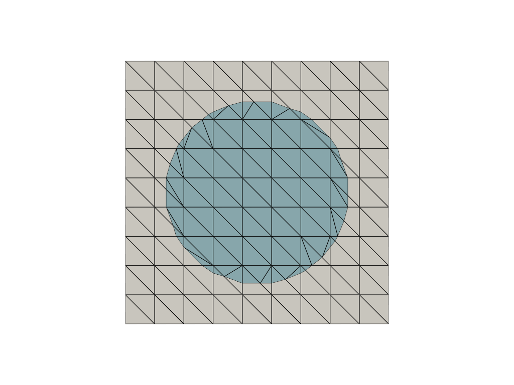
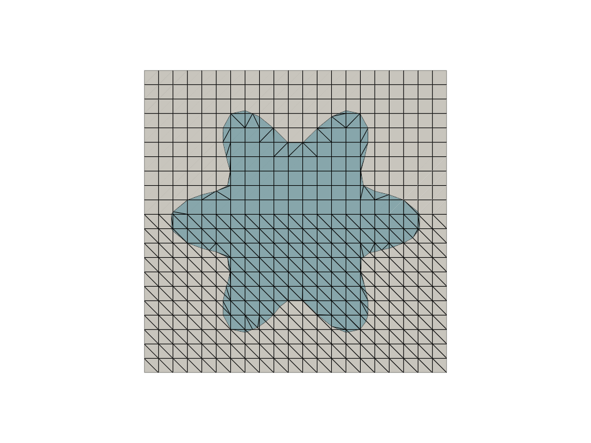
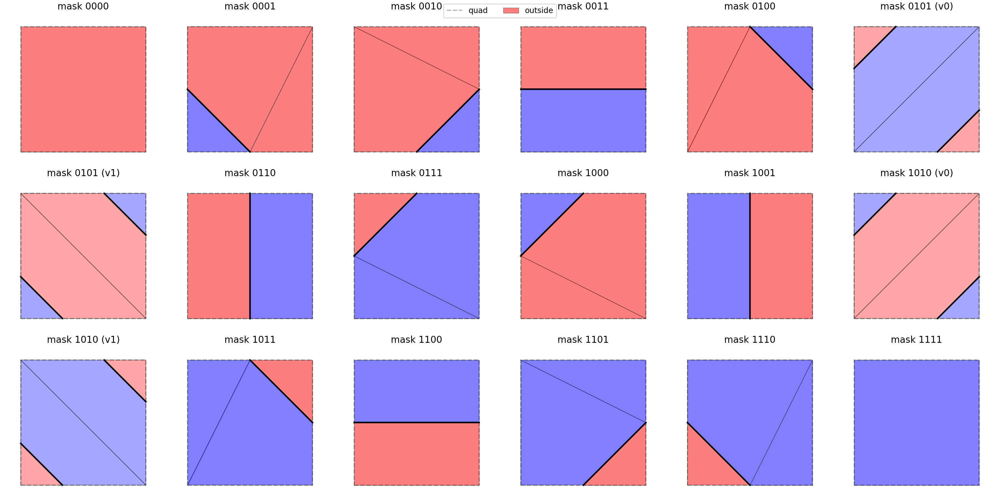
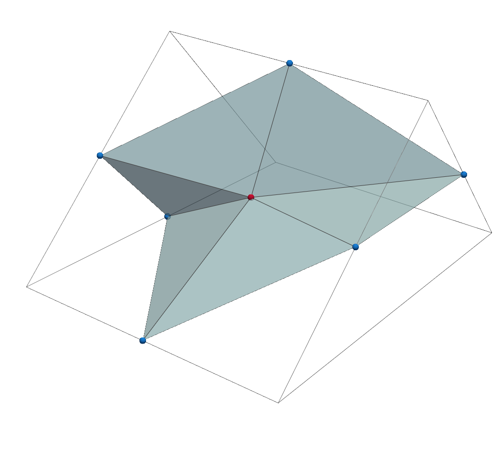
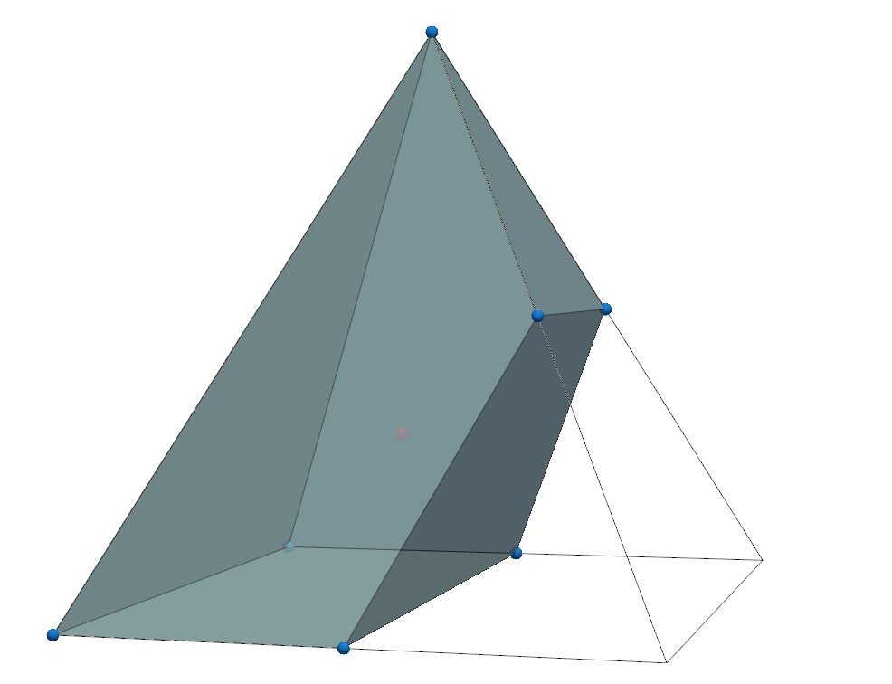
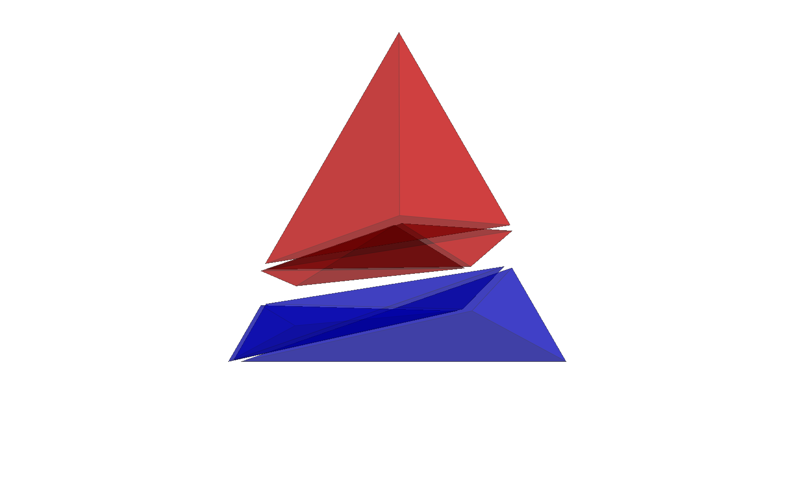
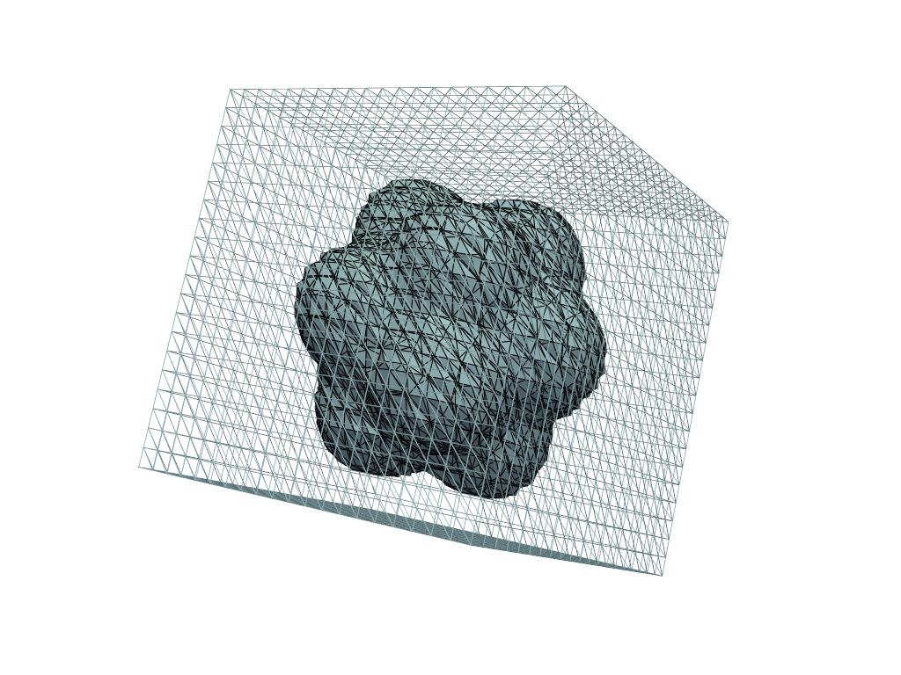
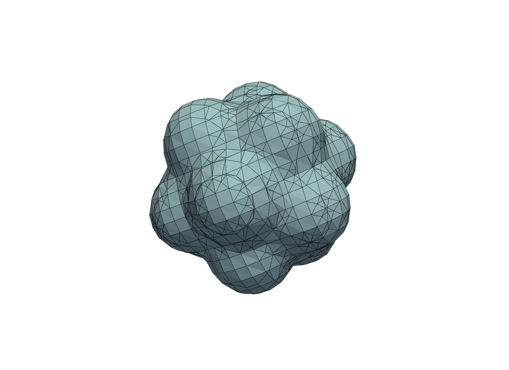
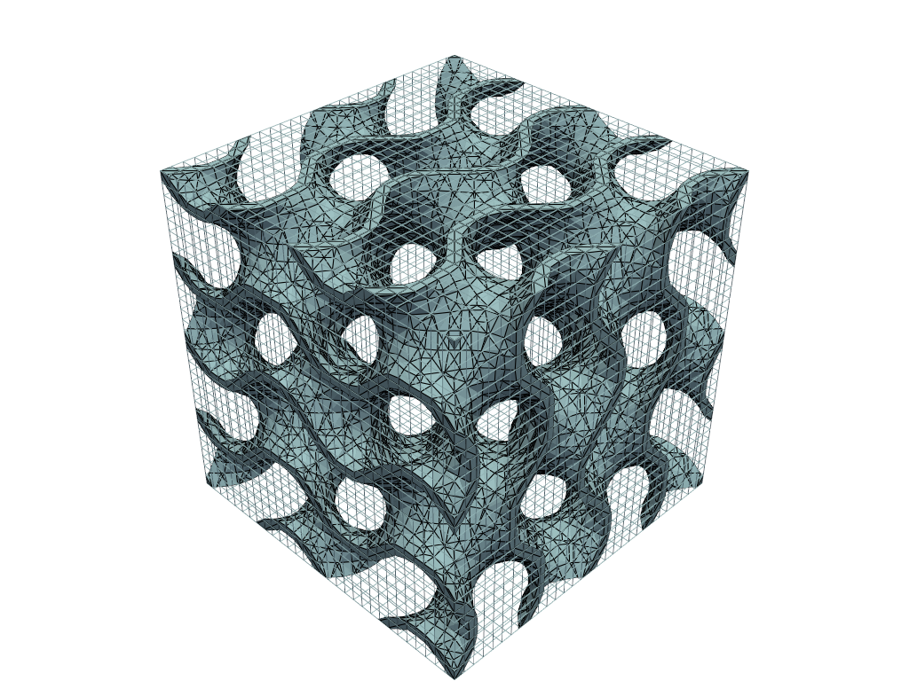

# CutCells

[](https://github.com/sclaus2/cutcells/actions/workflows/python-app.yml)


**CutCells** is a lightweight **C++20 geometry kernel with Python bindings** to compute **cut-cell decompositions** of standard mesh elements by an **implicit surface / level set** `φ(x)`.

Given one parent cell (or a whole mesh) and the level set values on its vertices, CutCells builds a **local sub-mesh** that describes:

* the **inside** region `φ < 0`,
* the **outside** region `φ > 0`,
* and/or the **interface** `φ = 0` (as facets/segments embedded in the cell),

with **explicit connectivity** and **element types**.

It is designed as a building block for **unfitted / immersed FEM** workflows (e.g. **CutFEM**), where robust cut geometry and stable parent mappings are required for runtime quadrature.

## Supported cell types

Current parent cell support:

* 1D: **interval**
* 2D: **triangle**, **quadrilateral**
* 3D: **tetrahedron**, **hexahedron**, **prism**, **pyramid**

Cells may lie in a space of higher dimension: the facets of a mesh (triangles
and quadrilaterals in 3D, intervals in 2D or 3D) and surface meshes are cut and
integrated as the cells they are, with areas and lengths on them.

Level sets can be **Pk** (interpolated, any degree) or **analytic** (exact
geometry, e.g. from ShapeForest), with any number of level sets per cell. A
level set can also be **made of level sets**, for shapes with sharp edges:
CutCells cuts with its smooth level sets, so edges stay exact. Two backends
integrate the selected parts:

* **quadrays** (the default): high-order quadrature on curved cut cells, for
  affine cells.
* **lookup tables** (`backend="lut"`): straight pieces on Pk-iso-P1 templates.

The low-level single-cell API also cuts **P2 triangles (6 nodes)** and **P2
tetrahedra (10 nodes)** (`higher_order_cut`), by subdivision into linear
sub-cells.

## Performance and dependencies

* **Few dependencies**: the computational core is plain C++.
* **Python bindings via nanobind**: CutCells exposes arrays in NumPy-friendly form and is designed to avoid unnecessary overhead.
* **Zero-copy where possible**: large buffers (coords, connectivity/offsets, parent IDs, provenance tags) are exposed as **views** when layout permits, minimizing memory traffic between C++ and Python.

## Applications

CutCells is intended as a reusable geometry backend for:

* **CutFEM / unfitted FEM**: robust sub-cell and interface extraction for integration on `Ω∩K` and `Γ∩K`
* **runtime quadrature** generation 
* general embedded geometry workflows where remeshing is undesirable

## Example gallery 


Below is a gallery of example outputs generated by CutCells and the provided Python demos. See `python/demo/` for scripts to reproduce these images.

<table>
	<tr>
		<td align="center">
			<br/>
			<sub>2D mesh cut by a circular level set</sub>
		</td>
        <td align="center">
			<br/>
			<sub>Hybrid mesh (quads+tris) cut by flower level set</sub>
		</td>
		<td align="center">
			<br/>
			<sub>Quad cases with disambiguation panels</sub>
		</td>
	</tr>
	<tr>
		<td align="center">
			<br/>
			<sub>Cut prism (wedge) demo</sub>
		</td>
		<td align="center">
			<br/>
			<sub>Cut pyramid demo</sub>
		</td>
        <td align="center">
			
            <br/>
			<sub>Cut tetrahedron demo</sub>
		</td>
	</tr>
	<tr>
		<td align="center">
			<br/>
			<sub>Tetrahedral mesh cut by a popcorn level set</sub>
		</td>
		<td align="center">
			<br/>
			<sub>Hexahedral mesh cut by popcorn level set</sub>
		</td>
        		<td align="center">
			<br/>
			<sub>Hexahedral mesh cut by gyroid level set</sub>
		</td>
	</tr>
</table>

# Installation

CutCells can be installed as a standalone C++ library and as a Python package.
For downstream packages such as CutFEMx, install the C++ core into the active
environment first, then build the Python extension against that installed CMake
package.

The following conda-forge workflow has been tested with FEniCSx 0.11:

```console
mamba create -n cutcells-dev -c conda-forge \
  python=3.12 cmake ninja pkg-config compilers \
  scikit-build-core nanobind numpy pytest
mamba activate cutcells-dev

export CONDA_PREFIX="${CONDA_PREFIX:?activate the conda environment first}"
export CMAKE_PREFIX_PATH="$CONDA_PREFIX"
export PYTHONNOUSERSITE=1
export CC="$CONDA_PREFIX/bin/clang"
export CXX="$CONDA_PREFIX/bin/clang++"
```

On macOS with conda-forge clang, also use:

```console
export CMAKE_ARGS="-DCMAKE_OSX_DEPLOYMENT_TARGET=13.4"
export CXXFLAGS="-D_LIBCPP_ENABLE_EXPERIMENTAL -D_LIBCPP_HAS_NO_EXPERIMENTAL_TZDB -D_LIBCPP_HAS_NO_EXPERIMENTAL_SYNCSTREAM -D_LIBCPP_HAS_NO_INCOMPLETE_PSTL"
```

Install the C++ core from the repository root:

```console
cmake -G Ninja -S cpp -B build/cutcells \
  -DCMAKE_BUILD_TYPE=Release \
  -DCMAKE_INSTALL_PREFIX="$CONDA_PREFIX" \
  -DCMAKE_PREFIX_PATH="$CONDA_PREFIX" \
  -DCMAKE_OSX_DEPLOYMENT_TARGET=13.4
cmake --build build/cutcells --target install
```

On Linux, omit the `-DCMAKE_OSX_DEPLOYMENT_TARGET=13.4` line from the direct
CMake configure command.

Then install the Python package against that installed core:

```console
python -m pip install --no-build-isolation --no-deps --force-reinstall \
  ./python
```

Verify the install:

```console
python - <<'PY'
import cutcells
print("CutCells import ok:", cutcells.__file__)
PY
```

The Python package requires the installed CutCells C++ CMake package. Keep
`CMAKE_PREFIX_PATH` pointed at the active environment prefix so
`find_package(CutCells)` resolves the same library used by downstream packages.

## Running demos

There are demos for both the C++ and the Python interface.
For the C++ interface the demos are located in `cpp/demo`. The C++ demos are built with
```console
cmake -S cpp/demo/cut_triangle -B build/cut_triangle -DCMAKE_BUILD_TYPE=Release
cmake --build build/cut_triangle
```
from the repository root. If CutCells was installed into a custom prefix, pass
that prefix through `CMAKE_PREFIX_PATH`.

The Python demos are located in `python/demo`.

## Documentation

The initial Sphinx/MyST documentation source is in `docs/`. It covers
installation, a Python quickstart, mesh views, level sets, selection
expressions, quadrature/output, and a compact API overview.

Build it with:

```console
cd docs
python -m pip install -r requirements.txt
bash build_docs.sh build
```

The generated site is written to `docs/_build/html/index.html`. To serve it
locally, run:

```console
bash build_docs.sh serve --port 8000
```

## Third-party notices

Some generated clip/cut case tables (hexahedron/prism/pyramid) are derived from
VTK's `vtkTableBasedClipCases.h`. VTK's BSD-3-Clause license text is included
in `third_party/VTK-Copyright.txt`.

Some generated quadrature lookup tables are produced offline with Basix
`make_quadrature`. Basix's MIT license text is included in
`third_party/Basix-LICENSE.txt`.

The comparison drivers in `benchmarks/` use a pinned Algoim snapshot under
`third_party/algoim`. Algoim's license, upstream commit, and local patch notes
are included with the vendored copy. See `third_party/THIRD_PARTY_NOTICES.md`
for the consolidated notice list.

## Dependencies

CutCells requires a C++20 compiler and depends on the C++ standard template library.
For the python interface, CutCells requires [`nanobind`](https://github.com/wjakob/nanobind).

At runtime for the python examples, CutCells requires [`numpy`](https://numpy.org) and [`pyvista`](https://pyvista.org/) for visualizations.

The library contains python `pytest` tests in `python/tests`.

### Quadrature backends

The Python `MeshPart.quadrature` API uses quadrays by default; the lookup
tables give straight pieces:

```python
result = cutcells.cut(mesh, phi)                    # quadrays
rules = result[phi < 0].quadrature(order=4)         # exact for degree 4 on flat pieces
straight = result[phi < 0].quadrature(order=4, backend="lut")
same = result["phi < 0"]                            # a selection string does the same
```

### Level sets made of level sets

A shape with sharp edges, such as a ball outside a cylinder, is given as the
smooth level sets it is made of and its inside, the selection of them where
it is negative. Selections of it expand into selections of them, and `.on`
picks a face:

```python
ball = cutcells.analytic_sphere(c, 0.8, signed_distance=False, name="ball")
cyl = cutcells.create_level_set(mesh, cylinder, degree=2, name="cyl")
ring = cutcells.LevelSetFunction(level_sets=[ball, cyl],
                                 inside=(ball < 0) & (cyl > 0), name="ring")

result = cutcells.cut(mesh, [ring, fluid])
solid = result[ring < 0]                    # ring.ball < 0 and ring.cyl > 0
around = result[(ring > 0) & (fluid < 0)]
hole = result[ring == 0].on("cyl")          # the face on the cylinder
```

### Algoim (benchmarks only)

Algoim is no longer part of the library or the Python package;
`backend="algoim"` raises. The comparison drivers in `benchmarks/` compare
quadrays against the vendored Algoim snapshot in `third_party/algoim`.
Configure that separate CMake project with `-DCUTCELLS_WITH_ALGOIM=ON` and
with `CONDA_PREFIX` set. CMake then takes the conda environment's LAPACK
instead of Apple's Accelerate on macOS, which lacks the LAPACKE symbols Algoim
needs.
