# CutCells

[](https://github.com/sclaus2/cutcells/actions/workflows/python-app.yml)
[](https://sclaus2.github.io/CutCells/)


**CutCells** cuts the cells of a mesh by one or more level sets `φ(x)` and
returns the inside, outside and interface pieces, with explicit connectivity
and high-order quadrature rules. It is a geometry kernel for unfitted finite
element methods (CutFEM): a C++20 core with no dependencies beyond a compiler,
and a Python interface that hands arrays to and from NumPy without copies.

<p align="center">
  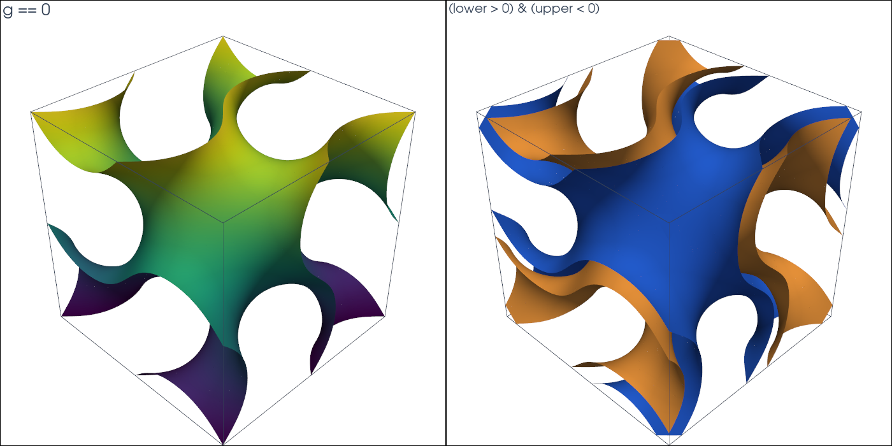<br/>
  <sub>A gyroid cut out of 4096 hexahedra (left) and a sheet between two level sets around it (right), drawn from the curved pieces CutCells returns.</sub>
</p>

```console
pip install cutcells
```

To build from source, see [Installation](#installation).

**[Documentation](https://sclaus2.github.io/CutCells/)** · **[Tutorials](https://sclaus2.github.io/CutCells/tutorials/index.html)** · **[Python API](https://sclaus2.github.io/CutCells/reference/python-api.html)**

## Quick example

Cut a triangle mesh by a circle, then integrate over the disk and along its
boundary:

```python
import numpy as np
import cutcells

mesh = cutcells.rectangle_mesh(-1.0, -1.0, 1.0, 1.0, 41, 41, cell_type="triangle")

def phi(X):
    # X has shape (gdim, num_points)
    return np.sqrt(X[0] ** 2 + X[1] ** 2) - 0.55

level_set = cutcells.create_level_set(mesh, phi, degree=2, name="phi")
result = cutcells.cut(mesh, level_set)

inside = result[level_set < 0]       # whole cells and the cut pieces inside
interface = result[level_set == 0]   # the curve phi = 0

print("area     ", inside.quadrature(order=4, mode="full").weights.sum())
print("perimeter", interface.quadrature(order=4, mode="cut_only").weights.sum())
```

Each rule holds points, weights and the background cell of every point, ready
for assembly.

## Features

### High-order quadrature on curved cut cells

The default backend, **quadrays**, integrates the cut pieces of affine cells as
the curved regions they are. Points are traced along rays from a flat base piece
to the zero set of the level set, so the rule follows the true geometry, not a
straight approximation of it. The level set can be a **Pk interpolant** of any
degree or **analytic**: with exact geometry the error drops to round-off.

<table>
  <tr>
    <td align="center" width="40%">
      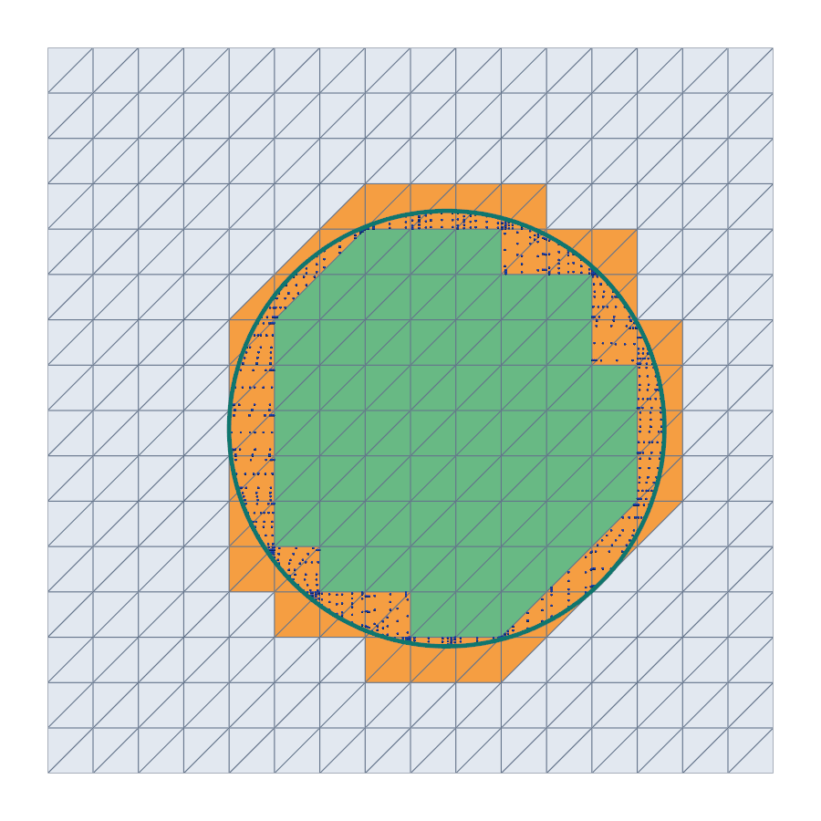<br/>
      <sub>Whole cells (green), cut cells (orange) and the quadrature points of the cut pieces.</sub>
    </td>
    <td align="center" width="60%">
      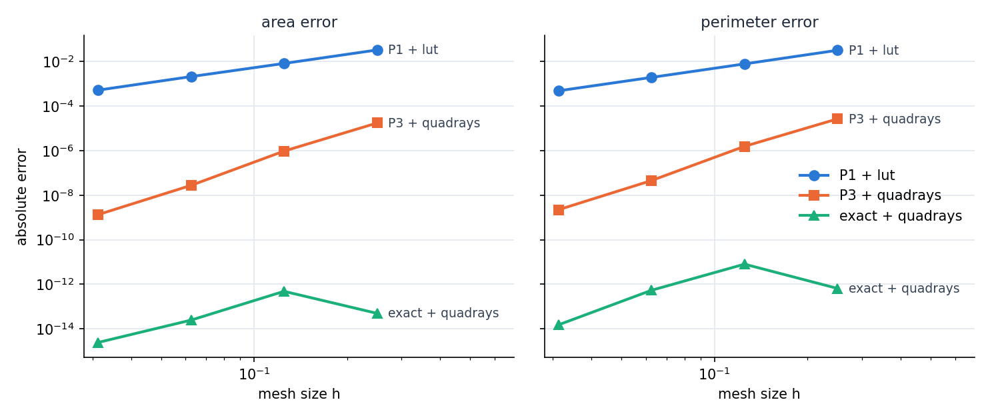<br/>
      <sub>Area and perimeter errors of a disk: straight pieces (rate 2), a P3 level set (rate 4) and exact geometry (round-off).</sub>
    </td>
  </tr>
</table>

The **lookup tables** (`backend="lut"`) give straight sub-cells on
Pk-iso-P1 templates, for every cell type below.

### Several level sets and selections

`cut` takes any number of level sets at once. Conditions on them select parts
of every dimension, with `&` and `|` or as strings; the dimension of a part
follows from its equality clauses:

```python
result = cutcells.cut(mesh, [ball, plane])

below = result[(ball < 0) & (plane < 0)]      # a volume
disk = result[(plane == 0) & (ball < 0)]      # a surface
circle = result["ball = 0 and plane = 0"]     # a curve
```

<p align="center">
  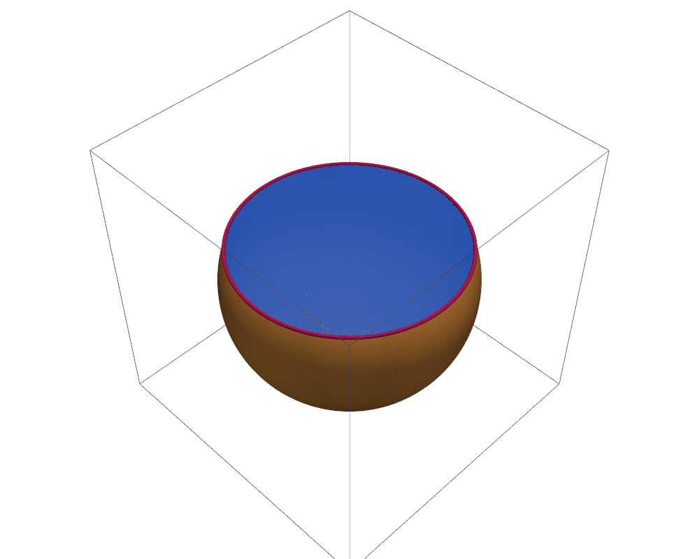<br/>
  <sub>The sphere below the plane, the disk where the plane crosses the ball and the circle where they meet, from one cut.</sub>
</p>

### Shapes with sharp edges: level sets made of level sets

A single level set for a shape with edges, such as a ball with a hole drilled
through it, has a kink that no interpolant represents well. CutCells takes the
smooth level sets the shape is made of instead, so the edges stay exact, and
each face of its surface can be picked on its own:

```python
ball = cutcells.analytic_sphere([0.0, 0.0, 0.0], 0.8, name="ball")
cyl = cutcells.create_level_set(mesh, cylinder, degree=3, name="cyl")
ring = cutcells.LevelSetFunction(level_sets=[ball, cyl],
                                 inside=(ball < 0) & (cyl > 0), name="ring")

result = cutcells.cut(mesh, ring)
solid = result[ring < 0]
zone = result[ring == 0].on("ball")         # the face on the sphere
rims = result[(ball == 0) & (cyl == 0)]     # the edges, two circles
```

<p align="center">
  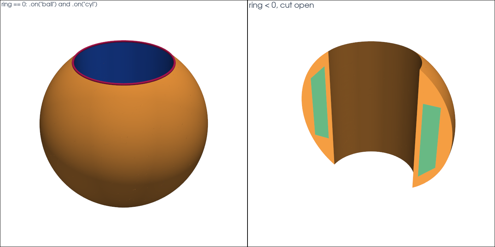<br/>
  <sub>A napkin ring: its two faces and the rims where they meet (left), and the solid cut open (right).</sub>
</p>

### Curved output for viewing

Every part has a visualisation mesh of curved Lagrange cells, written to VTU
or handed to PyVista, with the background cell of every piece:

```python
inside.write_vtu("ball.vtu", mode="full", degree=3)
grid = cutcells.to_pyvista(surface.visualization_mesh(mode="cut_only", degree=3))
```

<p align="center">
  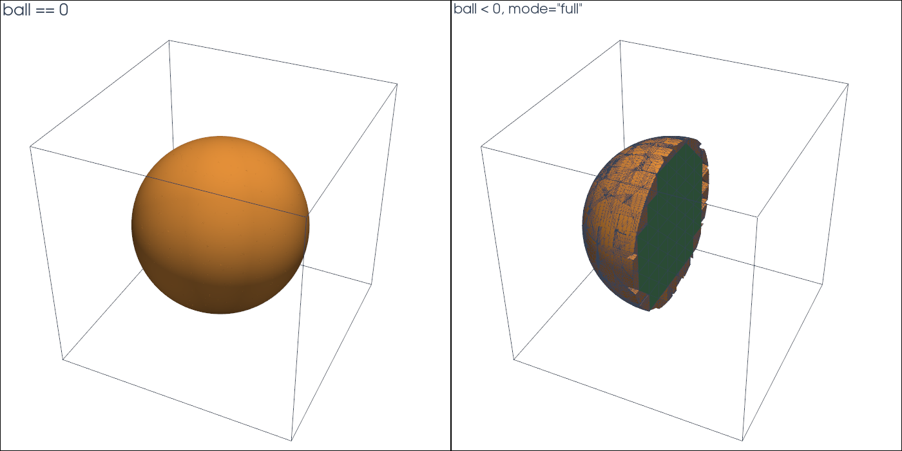<br/>
  <sub>A sphere from the curved pieces of 1524 cut tetrahedra (left) and the ball clipped open, whole cells in green and cut pieces in orange (right).</sub>
</p>

### Meshes and cells

* Parent cells: **intervals**, **triangles**, **quadrilaterals**,
  **tetrahedra**, **hexahedra**, **prisms** and **pyramids**, also mixed in
  one mesh.
* Cells in a space of higher dimension, such as the facets of a 3D mesh or a
  surface mesh, are cut and integrated as the cells they are.
* Pieces that lie exactly on a facet, edge or vertex of the mesh are
  integrated once, on that entity, with the cells that share it.
* `MeshView` wraps flat arrays of any mesh without copying; NumPy helpers
  build structured triangle, quadrilateral, tetrahedron and hexahedron
  meshes, and `mesh_from_pyvista` converts PyVista grids.
* Analytic level sets come from Python callables, from compiled geometry
  libraries through a capsule, or from ShapeForest shapes.
* The low-level single-cell API also cuts **P2 triangles (6 nodes)** and **P2
  tetrahedra (10 nodes)** (`higher_order_cut`), by subdivision into linear
  sub-cells.

### Performance and dependencies

* **Few dependencies**: the computational core is plain C++.
* **Python bindings via nanobind**: CutCells exposes arrays in NumPy-friendly
  form and is designed to avoid unnecessary overhead.
* **Zero-copy where possible**: large buffers (coords, connectivity/offsets,
  parent IDs, provenance tags) are exposed as **views** when layout permits,
  minimizing memory traffic between C++ and Python.

## Tutorials

The [tutorial book](https://sclaus2.github.io/CutCells/tutorials/index.html) works through ten demos in
`python/demo/`, from a first cut to sharp-edged shapes:

| Tutorial | Shows |
|---|---|
| [Disk](https://sclaus2.github.io/CutCells/tutorials/disk.html) | the workflow: mesh, level set, cut, selections, quadrature |
| [Convergence](https://sclaus2.github.io/CutCells/tutorials/convergence.html) | straight pieces, Pk level sets and exact geometry against the mesh size |
| [Ball](https://sclaus2.github.io/CutCells/tutorials/sphere.html) | 3D, analytic and interpolated level sets, curved VTU output |
| [Flower](https://sclaus2.github.io/CutCells/tutorials/flower.html) | a non-convex curve on quadrilaterals, and what each degree gains |
| [Ellipsoid](https://sclaus2.github.io/CutCells/tutorials/ellipsoid.html) | integrating functions: moments, normals, the divergence theorem |
| [Torus](https://sclaus2.github.io/CutCells/tutorials/torus.html) | hexahedra, and an analytic level set written in Python |
| [Plane on mesh facets](https://sclaus2.github.io/CutCells/tutorials/mesh-aligned.html) | surfaces on the mesh, integrated once, and the cells that take them |
| [Ball and plane](https://sclaus2.github.io/CutCells/tutorials/sphere-plane.html) | two level sets and selections of every dimension |
| [Napkin ring](https://sclaus2.github.io/CutCells/tutorials/napkin-ring.html) | a level set made of level sets and its faces |
| [Gyroid](https://sclaus2.github.io/CutCells/tutorials/gyroid.html) | hexahedra and a sheet between two level sets |

## Applications

CutCells is a geometry backend for:

* **CutFEM and unfitted finite elements**: integration on `Ω∩K` and `Γ∩K`
  for every cell `K` (CutCells is the geometry kernel of CutFEMx);
* **runtime quadrature** on implicitly defined domains;
* embedded geometry workflows where remeshing is undesirable.

## Example gallery

Below is a gallery of example outputs generated by CutCells and the provided Python demos. See `python/demo/` for scripts to reproduce these images.

<table>
	<tr>
		<td align="center">
			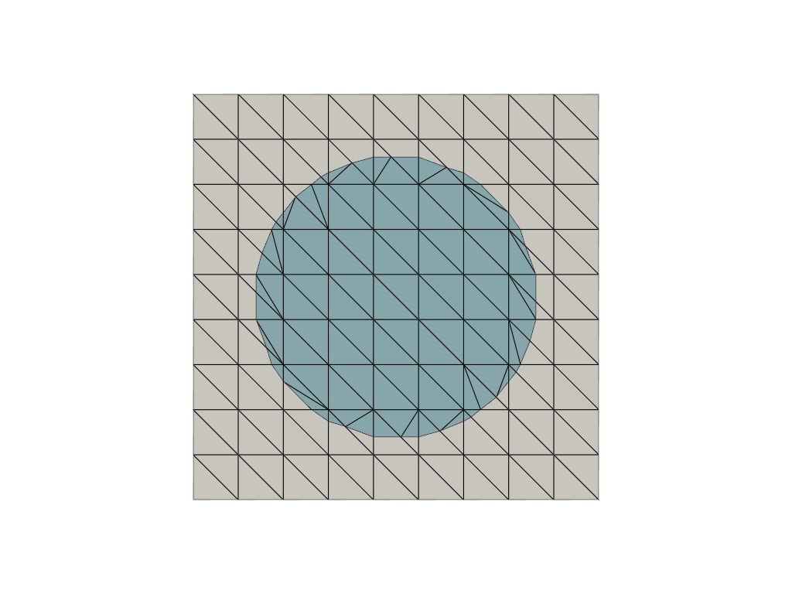<br/>
			<sub>2D mesh cut by a circular level set</sub>
		</td>
        <td align="center">
			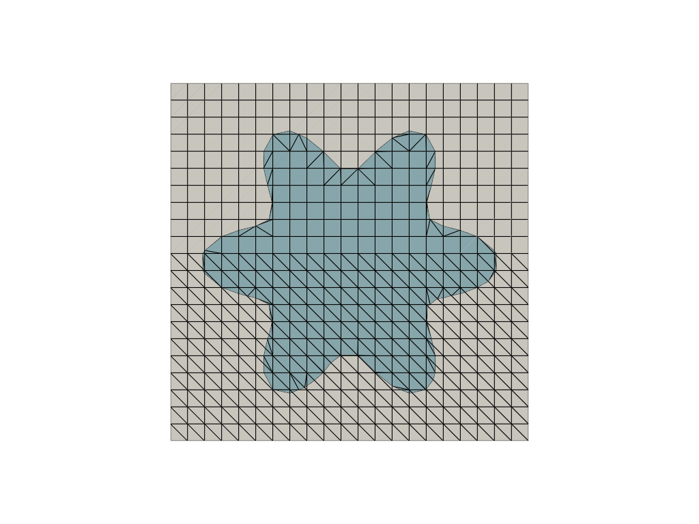<br/>
			<sub>Hybrid mesh (quads+tris) cut by flower level set</sub>
		</td>
		<td align="center">
			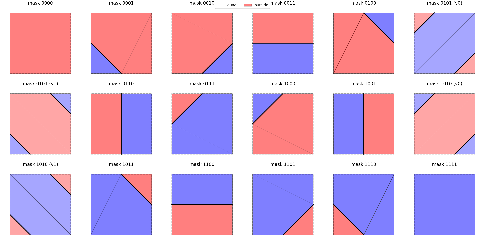<br/>
			<sub>Quad cases with disambiguation panels</sub>
		</td>
	</tr>
	<tr>
		<td align="center">
			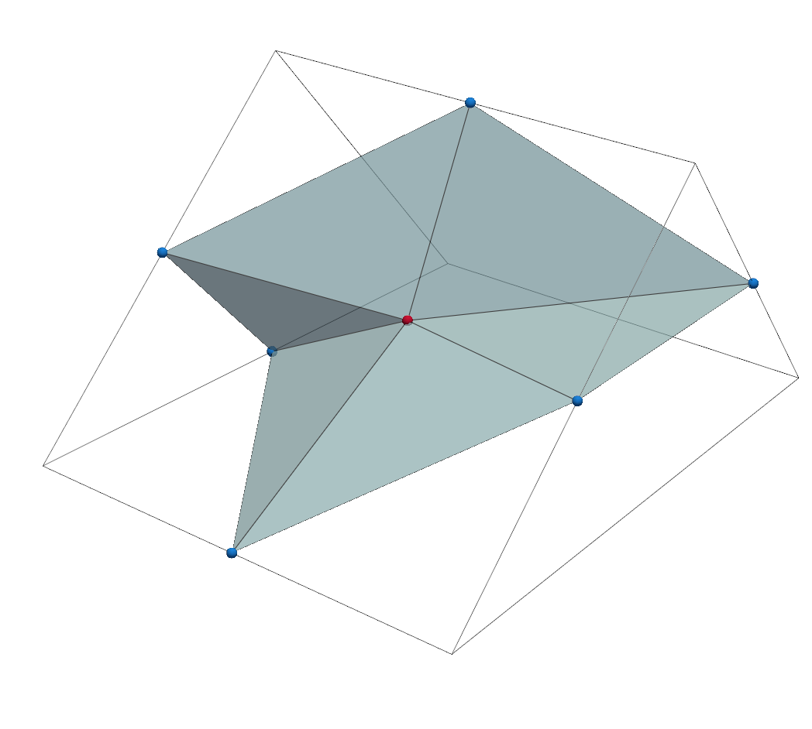<br/>
			<sub>Cut prism (wedge) demo</sub>
		</td>
		<td align="center">
			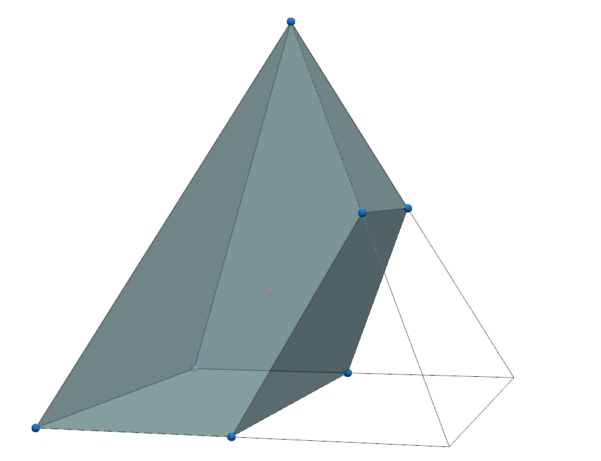<br/>
			<sub>Cut pyramid demo</sub>
		</td>
        <td align="center">
			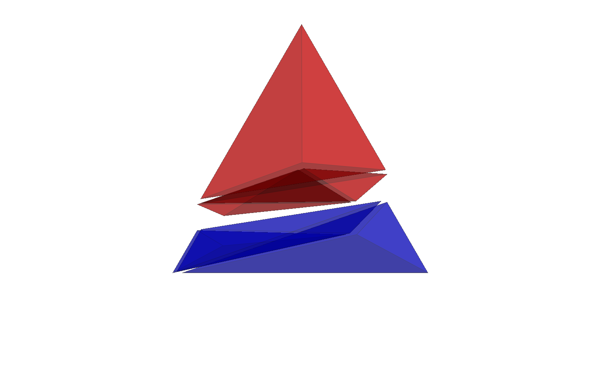
            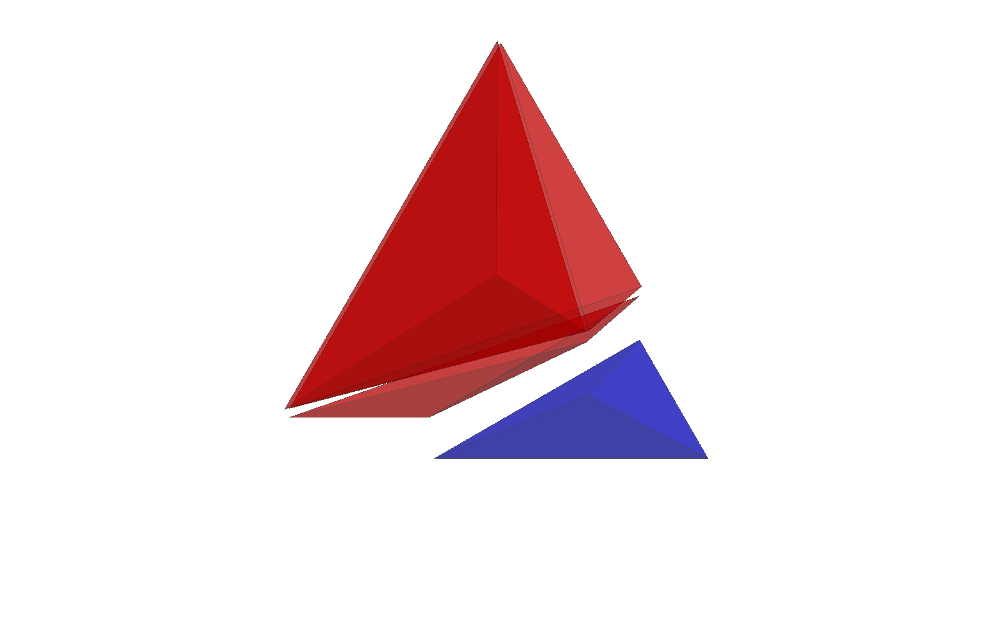<br/>
			<sub>Cut tetrahedron demo</sub>
		</td>
	</tr>
	<tr>
		<td align="center">
			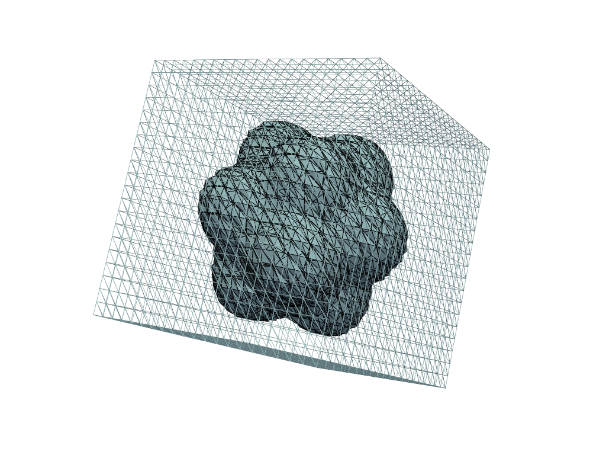<br/>
			<sub>Tetrahedral mesh cut by a popcorn level set</sub>
		</td>
		<td align="center">
			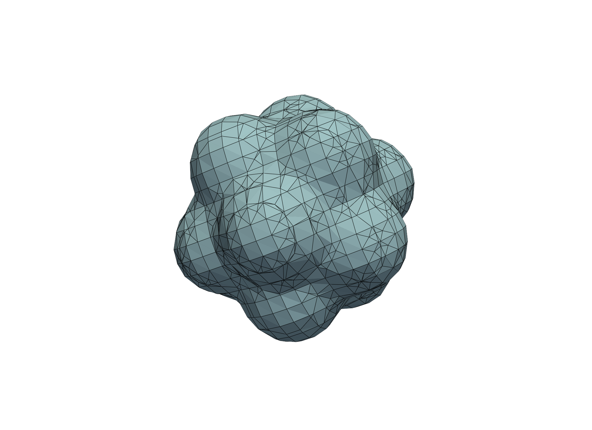<br/>
			<sub>Hexahedral mesh cut by popcorn level set</sub>
		</td>
        		<td align="center">
			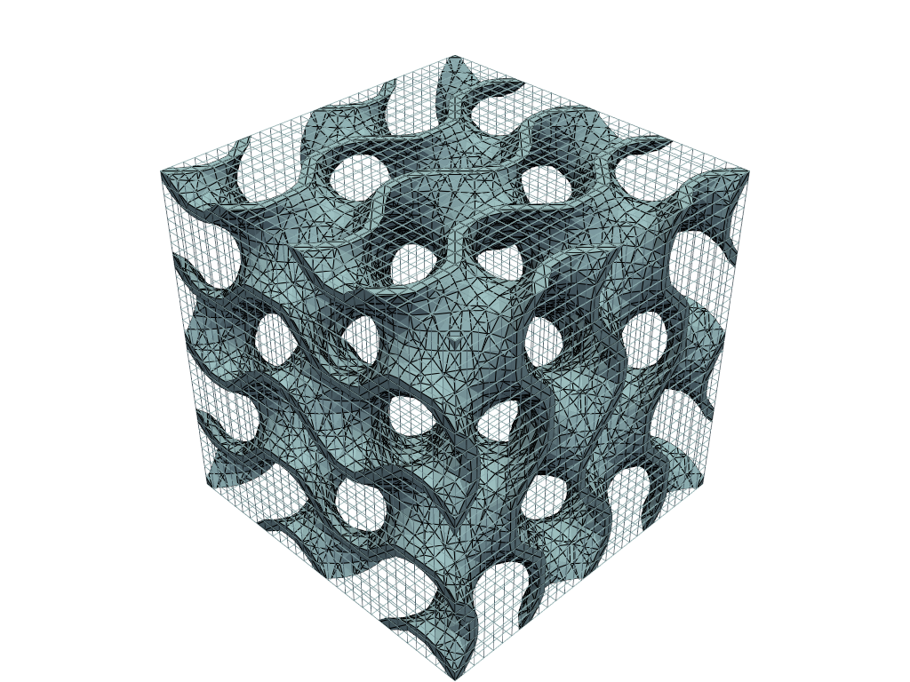<br/>
			<sub>Hexahedral mesh cut by gyroid level set</sub>
		</td>
	</tr>
</table>

## Installation

### With pip (recommended)

The standard way to install CutCells is the wheel from PyPI. It contains the
C++ core and needs nothing else (Linux and macOS, Python 3.10 and newer):

```console
pip install cutcells
```

### From source

Building from source is for developing CutCells and for downstream packages.
CutCells can be installed as a standalone C++ library and as a Python package.
For downstream packages such as CutFEMx, install the C++ core into the active
environment first, then build the Python extension against that installed CMake
package.

The following conda-forge workflow has been tested with FEniCSx 0.11:

```console
mamba create -n cutcells-dev -c conda-forge \
  python=3.12 cmake ninja pkg-config compilers \
  scikit-build-core nanobind numpy pytest
mamba activate cutcells-dev

export CONDA_PREFIX="${CONDA_PREFIX:?activate the conda environment first}"
export CMAKE_PREFIX_PATH="$CONDA_PREFIX"
export PYTHONNOUSERSITE=1
export CC="$CONDA_PREFIX/bin/clang"
export CXX="$CONDA_PREFIX/bin/clang++"
```

On macOS with conda-forge clang, also use:

```console
export CMAKE_ARGS="-DCMAKE_OSX_DEPLOYMENT_TARGET=13.4"
export CXXFLAGS="-D_LIBCPP_ENABLE_EXPERIMENTAL -D_LIBCPP_HAS_NO_EXPERIMENTAL_TZDB -D_LIBCPP_HAS_NO_EXPERIMENTAL_SYNCSTREAM -D_LIBCPP_HAS_NO_INCOMPLETE_PSTL"
```

Install the C++ core from the repository root:

```console
cmake -G Ninja -S cpp -B build/cutcells \
  -DCMAKE_BUILD_TYPE=Release \
  -DCMAKE_INSTALL_PREFIX="$CONDA_PREFIX" \
  -DCMAKE_PREFIX_PATH="$CONDA_PREFIX" \
  -DCMAKE_OSX_DEPLOYMENT_TARGET=13.4
cmake --build build/cutcells --target install
```

On Linux, omit the `-DCMAKE_OSX_DEPLOYMENT_TARGET=13.4` line from the direct
CMake configure command.

Then install the Python package against that installed core:

```console
python -m pip install --no-build-isolation --no-deps --force-reinstall \
  ./python
```

Verify the install:

```console
python - <<'PY'
import cutcells
print("CutCells import ok:", cutcells.__file__)
PY
```

The Python package requires the installed CutCells C++ CMake package. Keep
`CMAKE_PREFIX_PATH` pointed at the active environment prefix so
`find_package(CutCells)` resolves the same library used by downstream packages.

## Running demos

There are demos for both the C++ and the Python interface.
For the C++ interface the demos are located in `cpp/demo`. The C++ demos are built with
```console
cmake -S cpp/demo/cut_triangle -B build/cut_triangle -DCMAKE_BUILD_TYPE=Release
cmake --build build/cut_triangle
```
from the repository root. If CutCells was installed into a custom prefix, pass
that prefix through `CMAKE_PREFIX_PATH`.

The Python demos are located in `python/demo`. The `demo_*.py` scripts at its
top level are the chapters of the tutorial book in the documentation; they
need NumPy, and PyVista or matplotlib for their views.

## Documentation

The documentation is online at <https://sclaus2.github.io/CutCells/>. It
covers installation, a Python quickstart, mesh views, level sets, selection
expressions, quadrature and output, a tutorial book of ten demos, and a
compact API overview. Its source is in `docs/`.

Build it locally with:

```console
cd docs
python -m pip install -r requirements.txt
bash build_docs.sh build
```

The generated site is written to `docs/_build/html/index.html`. To serve it
locally, run:

```console
bash build_docs.sh serve --port 8000
```

## Third-party notices

Some generated clip/cut case tables (hexahedron/prism/pyramid) are derived from
VTK's `vtkTableBasedClipCases.h`. VTK's BSD-3-Clause license text is included
in `third_party/VTK-Copyright.txt`.

Some generated quadrature lookup tables are produced offline with Basix
`make_quadrature`. Basix's MIT license text is included in
`third_party/Basix-LICENSE.txt`.

The comparison drivers in `benchmarks/` use a pinned Algoim snapshot under
`third_party/algoim`. Algoim's license, upstream commit, and local patch notes
are included with the vendored copy. See `third_party/THIRD_PARTY_NOTICES.md`
for the consolidated notice list.

## Dependencies

CutCells requires a C++20 compiler and depends on the C++ standard template library.
For the python interface, CutCells requires [`nanobind`](https://github.com/wjakob/nanobind).

At runtime for the python examples, CutCells requires [`numpy`](https://numpy.org) and [`pyvista`](https://pyvista.org/) for visualizations.

The library contains python `pytest` tests in `python/tests`.

### Algoim (benchmarks only)

Algoim is no longer part of the library or the Python package;
`backend="algoim"` raises. The comparison drivers in `benchmarks/` compare
quadrays against the vendored Algoim snapshot in `third_party/algoim`.
Configure that separate CMake project with `-DCUTCELLS_WITH_ALGOIM=ON` and
with `CONDA_PREFIX` set. CMake then takes the conda environment's LAPACK
instead of Apple's Accelerate on macOS, which lacks the LAPACKE symbols Algoim
needs.
