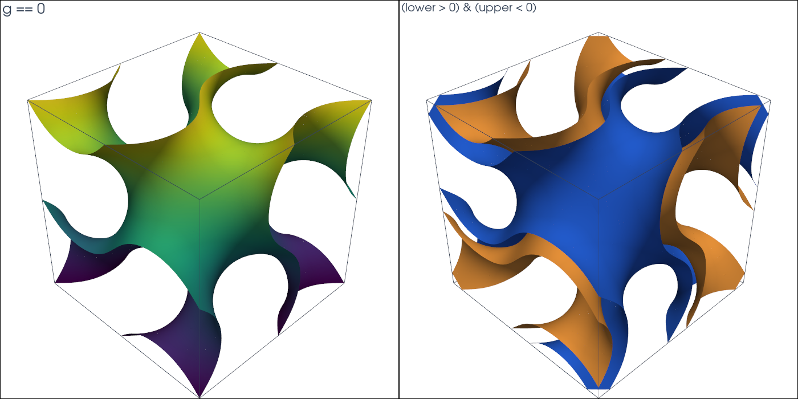

# CutCells documentation

CutCells is a C++20 geometry kernel with Python bindings for cutting mesh
cells by implicit level sets. It classifies every cell by Pk or analytic level
sets, selects regions such as `phi < 0`, `phi > 0` and `phi = 0`, including
combinations of several level sets, and gives quadrature rules and
visualisation meshes for them. These serve downstream unfitted and immersed
finite element workflows.

```{toctree}
:maxdepth: 2
:caption: Contents
:hidden:

getting-started/index
user-guide/index
tutorials/index
reference/index
```

```{raw} html
<figure class="tutorial-figure">
  
  <figcaption>A gyroid cut out of a hexahedral mesh: the curved pieces of the cut cells (left) and a sheet selected between two level sets (right). See the <a href="tutorials/gyroid.html">Gyroid tutorial</a>.</figcaption>
</figure>
```

```bash
pip install cutcells
```

## Getting started

- [Installation](getting-started/installation.md): install the wheel from PyPI,
  or build the C++ core and Python package in one environment.
- [Quickstart](getting-started/quickstart.md): cut a structured triangular mesh
  with a circular level set and integrate the selected part.

## User guide

- [Mesh views](user-guide/mesh-views.md): represent background meshes with
  coordinates, connectivity, offsets, and VTK cell types.
- [Level sets](user-guide/level-sets.md): interpolate implicit geometry on a
  mesh, or give it analytically, name level sets, and make level sets of level
  sets for shapes with sharp edges.
- [Cut results and selections](user-guide/selections.md): select parts with
  conditions such as `result[phi < 0]` or their strings, combine several level
  sets, pick the faces of a level set made of level sets, and infer the
  dimension.
- [Quadrature and output](user-guide/quadrature-output.md): create quadrature
  rules, visualisation meshes, and VTU files.
- [Algorithms and scope](user-guide/algorithms.md): supported cell types,
  classification, and the two backends, quadrays and the lookup tables.

## Tutorials

- [Tutorial book](tutorials/index.md): six chapters, each following a runnable
  demo in `python/demo`, from a disk in a square to a gyroid sheet, with exact
  values to check against and PyVista views.

## Reference

- [Python API overview](reference/python-api.md): compact reference for the
  current user-facing Python objects and functions.

## Current scope

This documentation starts with the Python workflow because it is the most common
entry point for CutFEMx and other runtime-quadrature users. The C++ API follows
the same concepts: a background mesh, one or more level sets, selected mesh
parts, and quadrature and output routines.
