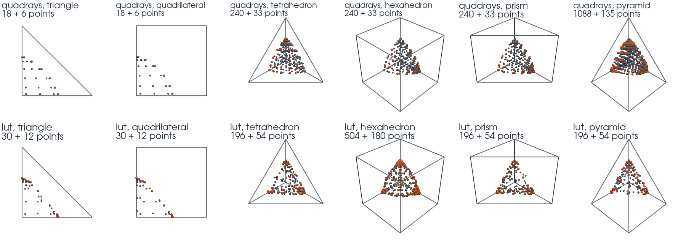

# Cell Shapes

This tutorial follows `python/demo/demo_cell_shapes.py`. The API does not change
with the shape of the background cell, but the cost and the accuracy do. The
demo cuts one disk or ball on triangles, quadrilaterals, tetrahedra, hexahedra,
prisms and pyramids, with both backends.

```{raw} html
<figure class="tutorial-figure">
  
  <figcaption>The points of one reference cell of each shape, at order 4 with a P2 level set: grey for the volume, orange for the surface. Top row quadrays, bottom row the lookup tables.</figcaption>
</figure>
```

## One Workflow

`box_mesh` builds all four 3D shapes on the same grid: hexahedra, six tetrahedra
or two prisms per grid cell, or six pyramids around a node at its centre.

```python
mesh = cutcells.box_mesh(-1, -1, -1, 1, 1, 1, n, n, n, cell_type=shape)
phi = cutcells.create_level_set(mesh, round_shape, degree=degree, name="phi")
result = cutcells.cut(mesh, phi, backend=backend)
volume = result[phi < 0].quadrature(order=order)
surface = result[phi == 0].quadrature(order=order)
```

The geometry is the disk or ball of radius 0.6 about $(0.1, -0.05, 0.03)$, with
13 grid points per side and order 6. The errors are those of the total area or
volume against the exact values. Level sets on pyramids take degree 2 at most;
the others use P3.

## Curved Pieces

```text
         shape   backend  cells  marked cut  on surface  all points  per surface cell  seconds  volume err  area err
      triangle  quadrays    288          49          49        2115            37 + 6    0.007     2.3e-06   3.7e-06
      triangle       lut    288          49          48        5220           94 + 15    0.004     1.6e-03   1.5e-03
 quadrilateral  quadrays    144          29          29        1119            32 + 6    0.003     1.8e-06   3.0e-06
 quadrilateral       lut    144          29          28        3812          121 + 15    0.003     2.0e-03   2.0e-03
   tetrahedron  quadrays  10368        1106        1106      713843          600 + 46    2.154     1.1e-06   2.8e-06
   tetrahedron       lut  10368        1106        1104      941304         703 + 150    0.360     4.5e-03   8.3e-03
    hexahedron  quadrays   1728         242         242      164353          610 + 69    0.532     9.5e-08   4.0e-07
    hexahedron       lut   1728         242         241      973248        3387 + 651    0.551     3.9e-03   1.0e-02
         prism  quadrays   3456         447         434      274628          577 + 56    0.879     8.4e-07   2.5e-06
         prism       lut   3456         447         433      952824        1837 + 363    0.433     3.9e-03   9.7e-03
       pyramid  quadrays  10368        9166         999     2273099        2117 + 159   28.402     2.2e-06   1.8e-05
       pyramid       lut  10368        9166         996      785112         681 + 108    2.024     5.2e-03   1.2e-02
```

**Hexahedra give the most for the points.** On the same grid, the P3 level set
has the same 50653 nodes on hexahedra and on tetrahedra, but on the hexahedra,
with their tensor space, the errors are about ten times lower, and the mesh
takes 4.3 times fewer points in all. Each cut cell takes about as many
points, and there are 4.6 times fewer cut cells. In 2D the difference in
accuracy is small.

**Prisms lie between.** Their errors are close to those of tetrahedra, at under
twice the points of hexahedra.

**The backends differ by three orders of magnitude or more.** quadrays integrates
the curved region, so its error is the interpolation error. The lookup tables
integrate straight pieces, so their error is that of the pieces: 1e-3 to 1e-2 on
every shape here. In exchange they are faster on tetrahedra (about six times) and
prisms (about two times), and they take as long on hexahedra. Their points are
many on these 3D cells because each cell is refined into straight pieces, each
with its own rule. The [next chapter](points-accuracy.md) compares them point for
point.

:::{admonition} Pyramids are expensive for now
:class: practice

On pyramids, `cut` marks 9166 of the 10368 cells as cut, while only 999 hold any
surface. The test uses the Bernstein form of $(1-z)^n \phi$, which vanishes at
the apex, so its bounds touch zero on nearly every cell. The errors in the table
are in line with the other shapes, but quadrays spends time on cells it could
skip: 28 s here, against 0.5 s on hexahedra. Use pyramids where
a mesh already has them, not by choice.
:::

## Straight Pieces

A P1 level set on simplices has flat zero sets, so both backends integrate the
same region:

```text
P1 level set, order 2
         shape   backend  per surface cell  seconds            volume              area
      triangle  quadrays             6 + 2    0.002    1.115879804252    3.756096790720
      triangle       lut             4 + 3    0.001    1.115879804252    3.756096790720
 quadrilateral  quadrays             6 + 2    0.002    1.116324052807    3.753200164792
 quadrilateral       lut             6 + 3    0.001    1.112321349703    3.751932405214
   tetrahedron  quadrays            74 + 6    0.211    0.869795779371    4.432990117310
   tetrahedron       lut             8 + 4    0.039    0.869795779371    4.432990117310
    hexahedron  quadrays            55 + 7    0.074    0.869842666698    4.426668513021
    hexahedron       lut           40 + 18    0.048    0.869795779371    4.432990117310
         prism  quadrays            81 + 9    0.300    0.869796622629    4.428779762676
         prism       lut           22 + 10    0.067    0.869858275018    4.436001169845
       pyramid  quadrays          350 + 27    5.413    0.882907281801    4.469140691487
       pyramid       lut            18 + 7    0.287    0.882915325565    4.473450725907
```

On triangles and tetrahedra the two agree to all 12 digits, and the lookup tables
need far fewer points: 8 + 4 against 74 + 6 on a tetrahedron. That is their place:
a P1 level set on a simplex, where they are exact for the region it describes.

On the other shapes the two answer different questions. The P1 level set of a
quadrilateral or hexahedron is multilinear, so its zero set is curved. quadrays
integrates that curved set and the lookup tables a straight approximation of it.
The hexahedra's lookup tables even give the tetrahedral mesh's numbers to all 12
digits.

## Run the Demo

```bash
python python/demo/demo_cell_shapes.py
python python/demo/demo_cell_shapes.py --n 9 --order 4 --no-plot
```

Options: `--n` grid points per side, `--order` of the quadrature, `--no-plot` to
skip the PyVista window and `--screenshot file.png` to save the view.
