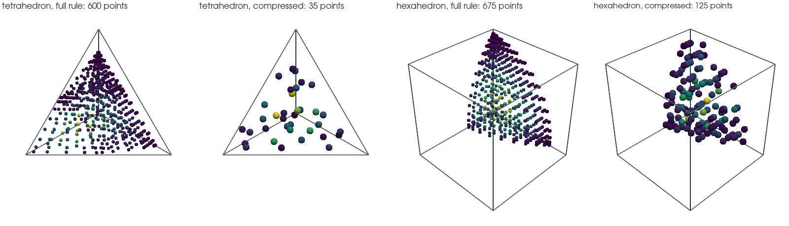

# Compression

This tutorial follows `python/demo/demo_compression.py`. A rule of order 8 on a
cut cell has hundreds or thousands of points, and most of them repeat
information. If only some moments matter, for example those of a mass matrix, a
small subset of the points with new weights gives the same integrals.

```{raw} html
<figure class="tutorial-figure">
  
  <figcaption>The volume rule of one cut reference cell at order 6, before and after compression onto degree 4. The colour is the weight, from small (dark) to large (light). The compressed points are a subset of the original ones, so they stay inside the part.</figcaption>
</figure>
```

## Usage

```python
rules = result[phi < 0].quadrature(order=8, mode="cut_only")
small, stats = cutcells.compress_rules(rules, degree=4, space="total")
print(stats.points_before, stats.points_after, stats.max_residual)
```

`degree` and `space` give the polynomials whose moments are kept: `"total"` for
total degree, usual on simplices, and `"tensor"` for the degree in each
coordinate, usual on quadrilaterals and hexahedra. A rule then needs at most as
many points as there are polynomials, whichever generator produced it. The
result has the same fields as `rules`.

## How Far the Points Fall

On the ball with a P2 level set and 9 grid points per side, order 8, compressed
onto degree 4:

```text
         shape     part   space  moments  before   after  ms/rule  residual
      triangle   volume   total       15      50      15     0.14   6.1e-16
      triangle  surface   total       15       6       6     0.00   0.0e+00
 quadrilateral   volume  tensor       25      50      25     0.08   5.0e-16
 quadrilateral  surface  tensor       25       9       9     0.00   0.0e+00
   tetrahedron   volume   total       35    1226      35     0.88   1.1e-15
   tetrahedron  surface   total       35      82      25     0.16   7.5e-13
    hexahedron   volume  tensor      125    1066     125    27.04   2.2e-14
    hexahedron  surface  tensor      125     102      77     0.67   3.4e-11
         prism   volume  tensor      125    1197     125    33.65   3.4e-13
         prism  surface  tensor      125     104      70     0.75   4.5e-11
       pyramid   volume  tensor      125    3032     125    52.86   3.0e-13
       pyramid  surface  tensor      125     295      86     4.87   5.4e-11
```

A tetrahedron goes from 1226 points to 35, a factor of 35. A hexahedron goes to
125, because the tensor space has more moments, and that is more costly to compute
too. 2D rules gain less, since they start small; a rule smaller than the moment
count is kept as it is, as on the 2D surfaces here. On a surface the moments are
not independent, so the points stop below the moment count.

## Mass Matrices

The mass matrix of degree $k$ needs the moments of degree $2k$. In each cut cell
the demo assembles the matrix in a monomial basis with the full rule (order 8)
and with the compressed one, in NumPy:

```text
         shape  k          points  difference   compress  assemble, full  compressed  pays after
   tetrahedron  1      1226 -> 10     7.6e-15     0.17ms          0.41ms      0.08ms         0.5
   tetrahedron  2      1226 -> 35     7.4e-15     0.95ms          0.99ms      0.16ms         1.1
   tetrahedron  3      1226 -> 84     1.1e-12    11.67ms          2.20ms      0.37ms         6.4
    hexahedron  1      1066 -> 27     4.4e-15     0.52ms          0.77ms      0.12ms         0.8
    hexahedron  2     1066 -> 125     1.0e-14    29.31ms          2.88ms      0.60ms        12.8
    hexahedron  3     1066 -> 331     1.7e-11    89.63ms          7.19ms      2.63ms        19.6
```

`difference` is the largest change of an entry relative to the largest entry,
over the cells. The matrices are unchanged to near round-off. `pays after` is how
many assemblies with the compressed rule repay its cost. At low degree that is a
single assembly. For Q3 on hexahedra it takes about 20. These times depend on the
assembly: C++ assembly per point is faster, so compression pays later there.

## What It Gives Up

Compression keeps only the chosen moments. An integrand beyond that degree is
integrated less accurately than with the full rule, for example a mass matrix of
degree 2 with a coefficient that is no polynomial:

```text
         shape  degree  points    exp(x + y + z)   1 / (1 + 4 r^2)
   tetrahedron       4      35           4.6e-04           4.4e-03
   tetrahedron       6      84           1.6e-06           3.0e-04
   tetrahedron       8     162           2.8e-09           2.5e-05
    hexahedron       4     125           2.0e-03           1.4e-03
    hexahedron       6     331           4.4e-06           1.0e-04
    hexahedron       8     588           1.2e-08           3.4e-06
```

These are differences from the full rule, measured like the matrices above. With
only the matrix's own degree 4, two to three digits remain. The exponential gains
a little under three digits for each two degrees, and the rational function about
one.

:::{admonition} Choosing the degree
:class: practice

Compress onto the degree of the whole integrand: twice the basis degree plus what
you need for the coefficient, and check the difference on one cell. Compress once
and reuse the rule when the geometry stays fixed over many assemblies, as in a
time step or a Newton iteration. If the geometry moves every step, compression
pays only at low degree.
:::

## Run the Demo

```bash
python python/demo/demo_compression.py
python python/demo/demo_compression.py --n 5 --order 6 --no-plot
```

Options: `--n` grid points per side, `--order` of the rules that are compressed,
`--no-plot` to skip the PyVista window and `--screenshot file.png` to save the
view.
