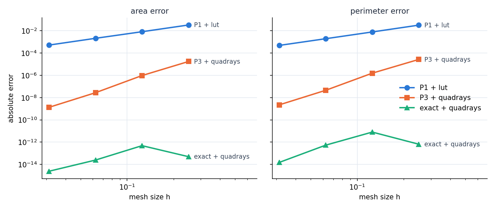

# Convergence

This tutorial follows `python/demo/demo_convergence.py`. It measures how the
area and the perimeter of a disk converge under mesh refinement, for three
ways of describing and integrating the disk.

```{raw} html
<figure class="tutorial-figure">
  
  <figcaption>Area and perimeter errors against the mesh size h, on triangular meshes of [-1, 1]^2.</figcaption>
</figure>
```

## Three Descriptions

The disk is the one of the previous chapter, $\{|x-c|<R\}$ with $R=0.6$, on
triangular meshes of size $h=2/(n-1)$.

`P1 + lut`
: A P1 level set, integrated on the straight pieces of the lookup tables. The
  pieces are polygons inscribed in the circle; the error decays as $h^2$.

`P3 + quadrays`
: A P3 level set, integrated by quadrays on the curved pieces. quadrays
  integrates the region of the interpolant to the quadrature order, so the
  error is the interpolation error of the level set, $h^{k+1}=h^4$.

`exact + quadrays`
: The analytic circle `cutcells.analytic_sphere`, integrated by quadrays. The
  geometry is exact, only the quadrature error remains, and it is near
  round-off on every mesh.

## Implementation

The three level sets differ only in how they are made and in the backend
passed to `cut`:

```python
def level_set(mesh, method):
    if method == "P1 + lut":
        return cutcells.create_level_set(mesh, circle, degree=1, name="phi"), "lut"
    if method == "P3 + quadrays":
        return cutcells.create_level_set(mesh, circle, degree=3, name="phi"), "quadrays"
    exact = cutcells.analytic_sphere([CENTER[0], CENTER[1], 0.0], RADIUS, name="phi")
    return exact, "quadrays"
```

and the rest of the study is the same for all of them:

```python
for n in sizes:
    mesh = cutcells.structured_triangle_mesh_view(-1.0, -1.0, 1.0, 1.0, n, n)
    for method in METHODS:
        phi, backend = level_set(mesh, method)
        result = cutcells.cut(mesh, phi, backend=backend)
        area = result[phi < 0].quadrature(order=order).weights.sum()
        perimeter = result[phi == 0].quadrature(order=order).weights.sum()
```

An analytic sphere in 2D is a disk; its centre takes three coordinates, of
which the third is ignored.

## Results

```text
area error (rate)
        h                  P1 + lut             P3 + quadrays          exact + quadrays
   0.2500         3.271e-02                 1.731e-05                 4.952e-14
   0.1250         8.127e-03 ( 2.01)         9.483e-07 ( 4.19)         4.834e-13 (-3.29)
   0.0625         2.085e-03 ( 1.96)         2.738e-08 ( 5.11)         2.465e-14 ( 4.29)
   0.0312         5.136e-04 ( 2.02)         1.330e-09 ( 4.36)         2.442e-15 ( 3.33)

perimeter error (rate)
        h                  P1 + lut             P3 + quadrays          exact + quadrays
   0.2500         3.170e-02                 2.650e-05                 6.510e-13
   0.1250         7.739e-03 ( 2.03)         1.547e-06 ( 4.10)         7.998e-12 (-3.62)
   0.0625         1.921e-03 ( 2.01)         4.509e-08 ( 5.10)         5.373e-13 ( 3.90)
   0.0312         4.796e-04 ( 2.00)         2.209e-09 ( 4.35)         1.510e-14 ( 5.15)
```

The straight pieces converge with rate 2 and the interpolated level set with
rate 4. With exact geometry the quadrature error is below $10^{-11}$ on every
mesh, and its rates say nothing: quadrays takes the points of the segments
near the circle's turning points in a variable anchored there (see *Curved
pieces in 3D* below).

:::{admonition} Reading the rates
:class: practice

The rate of the interpolated level set fluctuates around $k+1$ on single
steps: its error comes from the interpolation error along the curve, which
partly cancels on coarse meshes. Over a longer range the rate settles: for
P3, from $n=17$ to $n=513$ the errors are 9.5e-7, 2.7e-8, 1.3e-9, 1.9e-10,
1.3e-11 and 7.8e-13, rate 4.0 on average and 4.04 on the last step. Changing
the quadrature order, the points per segment or the quadrays margin does not
change these errors: they belong to the interpolant, not to the quadrature.
:::

:::{admonition} Curved pieces in 3D
:class: practice

quadrays bisects a box until the zero set's normal has a margin along one axis;
that sizes its leaves by the geometry, not by $h$, and nested meshes bring the
same leaves back. The margin bounds the slope of the height functions, not how
close their turning points come: where a cell face cuts a sphere near its
pole, the zero set on the face is a circle of any radius, whose turning point
can lie just beyond a box, and so can the sphere's silhouette seen along the
height direction. At such a fold the height function has a square-root branch
point, and the order's Gauss-Legendre points converge slowly near it, on
every mesh. So quadrays finds the folds near each curved box and gives the
segments that end within four lengths of one twice the points (three times
between two folds), in $s$ with $x = x_f \mp s^2$ anchored at the fold $x_f$,
in which the integrand is smooth (`QuadraysOptions.anchor_folds`). Anchoring
leaves about the same error on every mesh, so quadrays also checks each
curved box against one more point per segment and bisects it while the two
differ by more than the order's own rate allows at the cell's size,
$(h\kappa/2)^{2q}$ for curvature $\kappa$; pieces that converge as they should
get no extra points, flat pieces are not checked.

For the sphere of radius 0.6 about $(0.1, -0.05, 0.03)$ in $[-1, 1]^3$ at
`order=6`, the error of the area summed over the cells:

```text
                       n = 5      n = 9     n = 17     n = 33     n = 65
hexahedra
  plain points         3.0e-06    3.1e-06    5.1e-06    4.0e-07    4.8e-09
  the check alone      4.5e-06    2.5e-07    1.3e-08    5.1e-11    3.4e-13
  anchored alone       5.4e-12    5.5e-12    6.5e-12    2.2e-11    8.1e-12
  both (the default)   5.4e-12    5.5e-12    6.5e-12    2.1e-11    3.0e-13
tetrahedra
  plain points         3.1e-06    1.8e-06    2.3e-06    1.5e-07    3.4e-08
  the check alone      3.1e-06    5.2e-07    1.7e-08    8.9e-11    6.0e-13
  anchored alone       8.7e-12    1.0e-11    1.5e-11    1.5e-11    6.8e-12
  both (the default)   8.7e-12    1.0e-11    1.5e-11    1.4e-11    4.9e-13
```

The total over the mesh hides most of this: cells that share a face near a
pole err by opposite amounts. Anchored, the error stays near $10^{-11}$, where
the check alone starts from $10^{-6}$, until the check takes over on the
finest mesh. On the cut cells of the meshes up to $n = 33$ the default takes
1.3 to 2.7 times the points of plain points and 3 to 6 times their time, about
half of it for the check, and 1.1 to 3.6 times the time of the check alone.
`QuadraysOptions.anchor_folds = 0` gives plain points, `tolerance` sets a
relative accuracy instead of the order's rate (negative: no check), and
`points_per_segment` still fixes the points for studies.
:::

## Run the Demo

```bash
python python/demo/demo_convergence.py
python python/demo/demo_convergence.py --sizes 17 33 65 129 257 --no-plot
```

Options: `--sizes` grid points per side of the meshes, `--order` of the
quadrature, `--no-plot` to skip the matplotlib window and
`--screenshot file.png` to save the plot.
