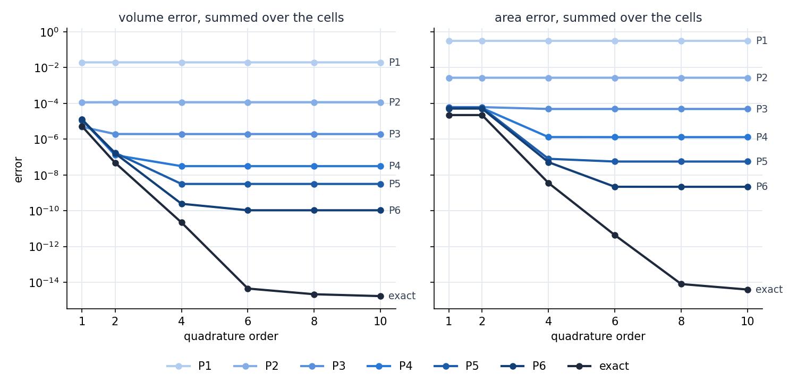

# Degree and Order

This tutorial follows `python/demo/demo_degree_order.py`. A level set has a
degree and a rule has an order, and each controls a different error: the degree
decides which region is described, the order how well that region is
integrated. The demo turns both on one ball and shows where each stops helping.

```{raw} html
<figure class="tutorial-figure">
  
  <figcaption>Volume and area errors against the quadrature order, for Pk level sets and the exact sphere, on 4096 hexahedra. Each curve falls until it reaches the interpolation error of its level set.</figcaption>
</figure>
```

## Measuring Per Cell

The ball has radius 0.6 about $(0.1, -0.05, 0.03)$, in a hexahedral mesh of
$[-1, 1]^3$ with 17 grid points per side. The reference is the exact sphere
integrated with 14 points per segment, cell by cell, and the error is the sum
of the cells' absolute errors:

```python
def per_cell(rules, n_cells):
    cells = np.repeat(rules.parent_map, np.diff(rules.offset))
    return np.bincount(cells, weights=rules.weights, minlength=n_cells)

error = np.abs(per_cell(rules, n_cells) - reference).sum()
```

The error of the total would look far better, because neighbouring cells err by
opposite amounts. For P2 at order 6 the total volume is off by 6.1e-7, while the
cells are off by 1.2e-4 together. A cut finite element method assembles cell by
cell, so the per-cell number is the one that matters to it.

## Two Dials

```python
phi = cutcells.create_level_set(mesh, sphere, degree=degree, name="phi")
result = cutcells.cut(mesh, phi)
volume = result[phi < 0].quadrature(order=order)
surface = result[phi == 0].quadrature(order=order)
```

```text
volume error
 order        1        2        4        6        8       10
    P1  2.0e-02  2.0e-02  2.0e-02  2.0e-02  2.0e-02  2.0e-02
    P2  1.2e-04  1.2e-04  1.2e-04  1.2e-04  1.2e-04  1.2e-04
    P3  4.9e-06  1.9e-06  1.9e-06  1.9e-06  1.9e-06  1.9e-06
    P4  1.3e-05  1.3e-07  3.1e-08  3.1e-08  3.1e-08  3.1e-08
    P5  1.1e-05  1.7e-07  3.1e-09  3.1e-09  3.1e-09  3.1e-09
    P6  1.3e-05  1.6e-07  2.4e-10  1.1e-10  1.1e-10  1.1e-10
 exact  5.3e-06  4.8e-08  2.2e-11  4.5e-15  2.1e-15  1.7e-15

area error
 order        1        2        4        6        8       10
    P1  3.1e-01  3.1e-01  3.1e-01  3.1e-01  3.1e-01  3.1e-01
    P2  2.7e-03  2.7e-03  2.7e-03  2.7e-03  2.7e-03  2.7e-03
    P3  6.2e-05  6.2e-05  4.9e-05  4.9e-05  4.9e-05  4.9e-05
    P4  5.5e-05  5.5e-05  1.3e-06  1.3e-06  1.3e-06  1.3e-06
    P5  5.8e-05  5.8e-05  8.0e-08  5.6e-08  5.6e-08  5.6e-08
    P6  5.1e-05  5.1e-05  5.2e-08  2.2e-09  2.2e-09  2.2e-09
 exact  2.2e-05  2.2e-05  3.6e-09  4.3e-12  8.0e-15  3.9e-15
```

Read each row from the left: it falls with the order and then stays flat. The
flat part is the interpolation error of the level set, which no rule can
improve. Read each column from the top: at a low order all the higher degrees
give about the same error, because the rule limits them.

So the two dials should be raised together. Up to P4, order 4 reaches the floor.
P5 and P6 need order 6. Beyond that
floor, extra order only adds points. Orders 1 and 2 give the same surface rule,
as the area columns show.

## What Each Dial Costs

```text
points per cut cell, volume / surface
 order         1         2         4         6         8        10
    P1    23/7      61/7     135/19    281/37    540/52    812/76
    P2    26/9      59/9     209/32    554/59   1018/98   1616/146
    P3    35/9      63/9     193/32    542/59   1003/99   1531/144
    P4    31/10     56/10    207/32    537/64   1051/106  1537/159
    P5    33/11     58/11    195/29    458/57    889/94   1290/140
    P6    33/11     58/11    190/29    439/55    857/91   1225/136
 exact    29/8      62/8     230/33    570/62   1055/101  1658/149
```

The order sets the number of points. The degree does not raise it: P6 at order 6
takes fewer points than P2 at order 6, and its error is five to six orders of
magnitude lower.

The degree is paid for elsewhere, in `cut`, which bounds each level set in its
Bernstein form on every cell:

```text
cost at order 6
        interpolate       cut  rules, us per cut cell
    P1       0.061s    0.014s                     461
    P2       0.064s    0.026s                    1287
    P3       0.107s    0.069s                    2181
    P4       0.145s    0.178s                    3142
    P5       0.319s    1.195s                    5255
    P6       0.582s    5.213s                   10825
 exact       0.000s    0.010s                    1578
```

The times were taken on a busy machine, so read them for their size only. `cut`
grows by three to seven times per degree on hexahedra, faster at the higher
degrees: a separate run took 4.7 s for P6 and 77 s for P8 on these 4096
hexahedra, against 1.4 s and 6.2 s on 24576 tetrahedra of the same grid. Degrees
up to about 5 are the practical range on hexahedra.

:::{admonition} When the geometry is known
:class: practice

The exact sphere needs no interpolation, reaches round-off at order 6 for the
volume and order 8 for the area, takes as many points as P2 and has the cheapest
`cut`. If you can write the level set
down, `analytic_sphere` and the other C++ level sets beat any interpolant. A
level set from Python callbacks gives the same volume to 11 digits but pays for
every call:

```text
analytic level sets, 512 hexahedra, order 4
     C++:    0.033 s, volume 0.904778684261
  Python:    3.757 s, volume 0.904778684262
```

Its `box_bounds` must also bound the gradient, as in the demo. With only the two
bounds of the value, quadrays cannot certify a box and bisects to its limits;
the same run took well over an hour and lost accuracy.
:::

## Run the Demo

```bash
python python/demo/demo_degree_order.py
python python/demo/demo_degree_order.py --n 9 --python-level-set --no-plot
```

Options: `--n` grid points per side, `--python-level-set` to time the callbacks,
`--no-plot` to skip the matplotlib window and `--screenshot file.png` to save
the plot.
