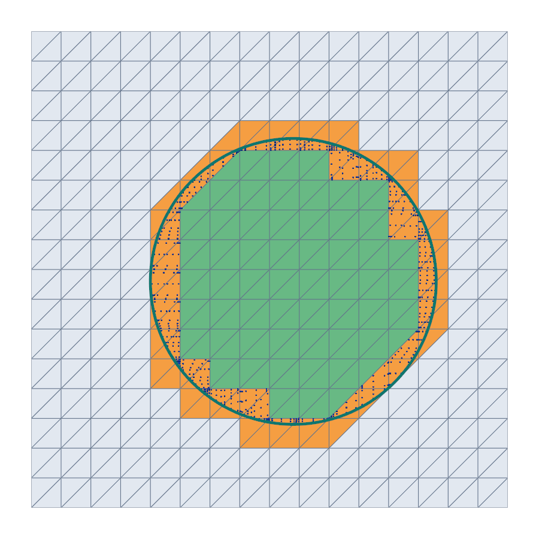

# Disk in a square

This tutorial follows `python/demo/demo_disk.py`. It goes through the whole
CutCells workflow in 2D: cut a triangular mesh by a circle, select the parts
on either side and on the circle, and integrate over them.

```{raw} html
<figure class="tutorial-figure">
  
  <figcaption>Green cells lie inside the circle, orange cells are cut, grey cells lie outside. The blue dots are the quadrature points of the disk in the cut cells, the teal curve is the circle.</figcaption>
</figure>
```

## Geometry

The background mesh covers the square $[-1,1]^2$. The circle of radius $R$
about $c$ is the zero set of the signed distance

$$
\phi(x)=|x-c|-R ,
$$

which splits the square into three parts:

$$
\Omega=\{x:\phi(x)<0\},\qquad
\Gamma=\{x:\phi(x)=0\},\qquad
\{x:\phi(x)>0\}.
$$

The demo checks three integrals against their exact values:

$$
|\Omega|=\pi R^2,\qquad |\Gamma|=2\pi R,\qquad
\int_\Omega |x-c|^2\,dx=\frac{\pi R^4}{2}.
$$

## Implementation Order

1. Build a structured triangular `MeshView`.
2. Interpolate $\phi$ as a P2 level set named `phi`.
3. Call `cutcells.cut` and select `phi < 0`, `phi == 0` and `phi > 0`.
4. Build quadrature rules for the disk and the circle and sum their weights.
5. Map the quadrature points to physical space and integrate $|x-c|^2$.
6. Write the parts as VTU files and show them with PyVista.

## Background Mesh

A `MeshView` holds the background mesh as flat arrays: coordinates,
connectivity, offsets and cell types. `structured_triangle_mesh_view` builds
one on a rectangle with NumPy, splitting each grid square into two triangles.

```python
import numpy as np
import cutcells

mesh = cutcells.structured_triangle_mesh_view(-1.0, -1.0, 1.0, 1.0, n, n)
```

`n` is the number of grid points per side; the demo's default `n = 25` gives
1152 triangles.

## Level Set

`create_level_set` interpolates a function on the mesh. The function receives
all interpolation points at once, as an array of shape `(gdim, num_points)`,
and returns one value per point:

```python
CENTER = (0.1, -0.05)
RADIUS = 0.6


def circle(X):
    return np.sqrt((X[0] - CENTER[0]) ** 2 + (X[1] - CENTER[1]) ** 2) - RADIUS


phi = cutcells.create_level_set(mesh, circle, degree=2, name="phi")
```

The name is the level set's name in selection strings (`"phi < 0"`) and in
the result.

## Cut and Select

`cut` classifies every cell by the level set: inside, cut, or outside. Indexing
the result with a condition built from the level set selects a part:

```python
result = cutcells.cut(mesh, phi)

inside = result[phi < 0]
interface = result[phi == 0]
outside = result[phi > 0]
```

A part knows its dimension, `2` for the disk and `1` for the circle, and its
cells: `inside.uncut_cells` lie wholly inside, `inside.cut_cells` are the cut
cells of which it holds a piece. The colours of the figure are
`result.domains[0]`, per cell 0 (inside), 1 (cut) or 2 (outside).

## Quadrature

`part.quadrature(order)` returns one quadrature rule per cell. With
`mode="full"` the disk's rules cover its whole cells as well as its pieces of
the cut cells; the weights are physical, so they sum to the area:

```python
inside_rules = inside.quadrature(order=4, mode="full")
interface_rules = interface.quadrature(order=4)

area = inside_rules.weights.sum()
perimeter = interface_rules.weights.sum()
```

By default the pieces are integrated with **quadrays**, which follows the
curved zero set of the P2 level set. `order` is the polynomial degree
integrated exactly on flat pieces.

## Integrating a Function

The points of a rule are given in the reference coordinates of its cell,
`rules.parent_map` gives the cell of each rule and `rules.offset` the points
of each rule. On a simplex mesh the affine map of each cell takes them to
physical space:

```python
def physical_points(mesh, rules):
    tdim = rules.tdim
    reference = rules.points.reshape(-1, tdim)
    cells = np.repeat(rules.parent_map, np.diff(rules.offset))
    nodes = mesh.connectivity.reshape(-1, tdim + 1)[cells]
    x = mesh.coordinates[nodes]  # (num_points, tdim + 1, gdim)
    return x[:, 0] + np.einsum("pi,pig->pg", reference, x[:, 1:] - x[:, :1])


x = physical_points(mesh, inside_rules)
f = (x[:, 0] - CENTER[0]) ** 2 + (x[:, 1] - CENTER[1]) ** 2
moment = np.dot(inside_rules.weights, f)
```

The same arrays are what an assembly code such as CutFEMx consumes: per cell,
reference points and physical weights.

## Output

A part writes its visualisation mesh as a VTU file, for ParaView. With quadrays
the cut pieces are Lagrange cells of the given degree, so the circle stays
curved:

```python
inside.write_vtu("disk.vtu", mode="full", degree=2)
interface.write_vtu("circle.vtu", mode="cut_only", degree=2)
```

`cutcells.to_pyvista` turns a `MeshView` or a part's visualisation mesh into a
PyVista grid; the demo draws the figure above from them:

```python
background = cutcells.to_pyvista(mesh)
background.cell_data["class"] = result.domains[0]
circle_curve = cutcells.to_pyvista(interface.visualization_mesh(mode="cut_only", degree=3))
```

## Results

```text
background cells: 1152, cut cells: 97
  phi < 0: 275 whole cells + 97 cut cells
  phi > 0: 780 whole cells + 97 cut cells
  phi = 0: 97 cut cells, dimension 1
    quantity            computed               exact      error
        area    1.13097538346401    1.13097335529233   2.03e-06
   perimeter    3.76991660113243    3.76991118430775   5.42e-06
 int |x-c|^2    0.20357593464074    0.20357520395262   7.31e-07
```

The errors are those of the P2 interpolant of the circle; the next chapter
separates them from the quadrature error.

## Run the Demo

```bash
python python/demo/demo_disk.py
python python/demo/demo_disk.py --n 49 --degree 3 --no-plot
```

Options: `--n` grid points per side, `--degree` of the level set, `--order` of
the quadrature, `--output-dir` for the VTU files, `--no-plot` to skip the
PyVista window and `--screenshot file.png` to render it to a file.
