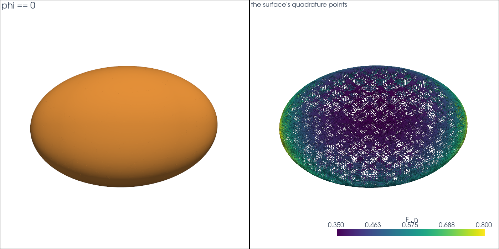

# Integrating Functions

This tutorial follows `python/demo/demo_ellipsoid.py`. A quadrature rule is
points and weights, so it integrates any function. On a rotated ellipsoid the
demo checks moments of the volume and, with normals from the level set, the
divergence theorem.

```{raw} html
<figure class="tutorial-figure">
  <iframe class="tutorial-frame" src="../_static/tutorials/ellipsoid-view.html" title="Interactive view of the ellipsoid" loading="lazy" allowfullscreen></iframe>
  <figcaption>The surface phi == 0 of the rotated ellipsoid, from the curved pieces of the cut cells. Drag to turn, scroll to zoom.</figcaption>
</figure>
```

## Geometry

The ellipsoid has semi-axes $(a_1,a_2,a_3)=(0.8,0.55,0.35)$ and centre $x_0$,
in axes turned by a rotation $Q$. With $y=Q(x-x_0)$,

$$
\phi(x)=\sqrt{\sum_i (y_i/a_i)^2}-1 .
$$

This is no signed distance, which CutCells does not need. The exact values are

$$
|\Omega|=\tfrac43\pi a_1a_2a_3,\qquad
\int_\Omega x\,dx=|\Omega|\,x_0,\qquad
\int_\Omega y_i^2\,dx=|\Omega|\,\frac{a_i^2}{5} .
$$

## Points in Physical Space

The rules hold, per background cell, reference points and physical weights.
On a simplex mesh the cell's vertices map the points:

```python
rules = result[phi < 0].quadrature(order=6, mode="full")

reference = rules.points.reshape(-1, 3)
cells = np.repeat(rules.parent_map, np.diff(rules.offset))
x = mesh.coordinates[mesh.connectivity.reshape(-1, 4)[cells]]
points = x[:, 0] + np.einsum("pi,pig->pg", reference, x[:, 1:] - x[:, :1])

centroid = rules.weights @ points / rules.weights.sum()
```

## Normals and the Divergence Theorem

The weights of a surface rule are surface measures, and the normal at a point
is the gradient of the level set, scaled. The field $F(x)=x-x_0$ has
divergence 3, so

$$
\int_\Gamma F\cdot n\,ds=3\,|\Omega| ,
$$

which ties the surface rule to the volume rule:

```python
surface = result[phi == 0].quadrature(order=6)
xs = physical_points(mesh, surface)
flux = np.dot(surface.weights, np.sum((xs - CENTER) * normals(xs), axis=1))
```

```{raw} html
<figure class="tutorial-figure">
  
  <figcaption>Left: the surface. Right: the quadrature points of the surface, coloured by F . n.</figcaption>
</figure>
```

## Results

For a P3 level set on 24576 tetrahedra:

```text
tetrahedra: 24576, cut cells: 1959
        quantity          computed             exact      error
          volume    0.645072721701    0.645073691537   9.70e-07
  flux of x - x0    1.935250556244    1.935221074611   2.95e-05
      centroid x    0.040000446944    0.040000000000   4.47e-07
      centroid y   -0.029999061579   -0.030000000000   9.38e-07
      centroid z    0.019999596705    0.020000000000   4.03e-07
       int y_1^2    0.082571834412    0.082569432517   2.40e-06
       int y_2^2    0.039027615843    0.039026958338   6.58e-07
       int y_3^2    0.015803460848    0.015804305443   8.45e-07
surface area: 3.9492319027 (no closed form)
```

The errors belong to the P3 interpolant. From $n=17$ to $n=33$ the volume error
falls to 1.9e-8 and the flux error to 2.1e-6.

## Run the Demo

```bash
python python/demo/demo_ellipsoid.py
python python/demo/demo_ellipsoid.py --n 33 --no-plot
```

Options: `--n` grid points per side, `--degree` of the level set, `--order` of
the quadrature, `--output-dir` for the VTU files, `--no-plot` and
`--screenshot file.png`.
