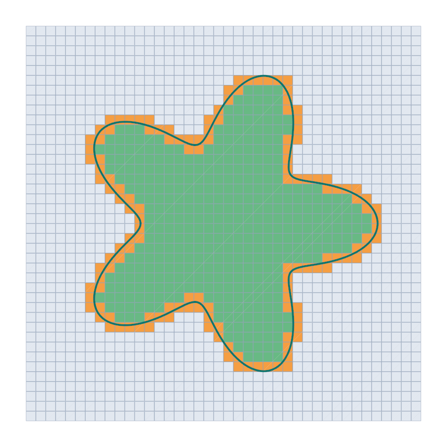

# Flower

This tutorial follows `python/demo/demo_flower.py`. One level set cuts a
quadrilateral mesh along a non-convex curve whose curvature changes strongly
from petal to petal, and the degree of the level set decides the accuracy.

```{raw} html
<figure class="tutorial-figure">
  
  <figcaption>Cells inside the flower (green), cut (orange) and outside (grey), with the curved zero set of the P3 level set.</figcaption>
</figure>
```

## Geometry

The curve is $r(\theta)=R\,(1+a\cos k\theta)$ with $R=0.6$, $a=0.3$ and $k=5$,
the zero set of

$$
\phi(x)=|x|-R\,(1+a\cos k\theta).
$$

Area and polar moment follow from the polar form, and the length is an
integral over $\theta$ that the trapezoidal rule gives to round-off, as the
integrand is periodic:

$$
|\Omega|=\pi R^2\left(1+\tfrac{a^2}{2}\right),\qquad
\int_\Omega|x|^2\,dx=\int_0^{2\pi}\frac{r^4}{4}\,d\theta,\qquad
|\Gamma|=\int_0^{2\pi}\sqrt{r^2+r'^2}\,d\theta .
$$

## Quadrilaterals and Degrees

`rectangle_mesh` builds the quadrilaterals; everything else is the workflow of
[Disk in a square](disk.md). Only `degree` changes from row to row of the
results, and `backend="lut"` gives the straight pieces of the lookup tables:

```python
mesh = cutcells.rectangle_mesh(-1.0, -1.0, 1.0, 1.0, n, n, cell_type="quadrilateral")

for degree in (1, 2, 3, 4):
    phi = cutcells.create_level_set(mesh, flower, degree=degree, name="phi")
    result = cutcells.cut(mesh, phi)
    area = result[phi < 0].quadrature(order=6, mode="full").weights.sum()
    length = result[phi == 0].quadrature(order=6).weights.sum()
```

## Integrating a Function

Rules hold reference points. On a mesh of parallelograms two edges of the cell
map them to physical space, and any function can then be integrated:

```python
reference = rules.points.reshape(-1, 2)
cells = np.repeat(rules.parent_map, np.diff(rules.offset))
x = mesh.coordinates[mesh.connectivity.reshape(-1, 4)[cells]]
points = x[:, 0] + reference[:, :1] * (x[:, 1] - x[:, 0]) + reference[:, 1:] * (x[:, 3] - x[:, 0])

moment = np.dot(rules.weights, np.sum(points**2, axis=1))
```

## Results

On $n=41$ points per side:

```text
quadrilaterals: 1600, cut cells: 140
exact: area = 1.181867156280, length = 5.410322100309, int |x|^2 = 0.259158868702
       level set        area error      length error   int |x|^2 error
   P1 + quadrays          2.73e-04          2.96e-02          1.00e-03
   P2 + quadrays          3.07e-06          9.56e-05          1.59e-06
   P3 + quadrays          1.24e-06          1.15e-05          2.06e-07
   P4 + quadrays          9.06e-09          2.39e-07          1.92e-09
        P3 + lut          6.11e-05          3.55e-03          1.55e-04
```

and on $n=81$:

```text
quadrilaterals: 6400, cut cells: 276
       level set        area error      length error   int |x|^2 error
   P1 + quadrays          7.23e-05          7.69e-03          2.54e-04
   P2 + quadrays          8.55e-07          7.97e-06          4.58e-08
   P3 + quadrays          7.10e-08          9.08e-07          8.37e-09
   P4 + quadrays          1.54e-10          8.09e-10          3.43e-11
        P3 + lut          1.45e-05          9.20e-04          3.95e-05
```

Straight pieces cannot follow the curve within a cell: for the same P3 level
set on $n=41$, the curved pieces of quadrays are about 50 times more accurate
in area and 300 times in length. The errors fall with the degree, though not
evenly from one degree to the next.

## Run the Demo

```bash
python python/demo/demo_flower.py
python python/demo/demo_flower.py --n 81 --no-plot
```

Options: `--n` grid points per side, `--order` of the quadrature,
`--output-dir` for the VTU files, `--no-plot` and `--screenshot file.png`.
