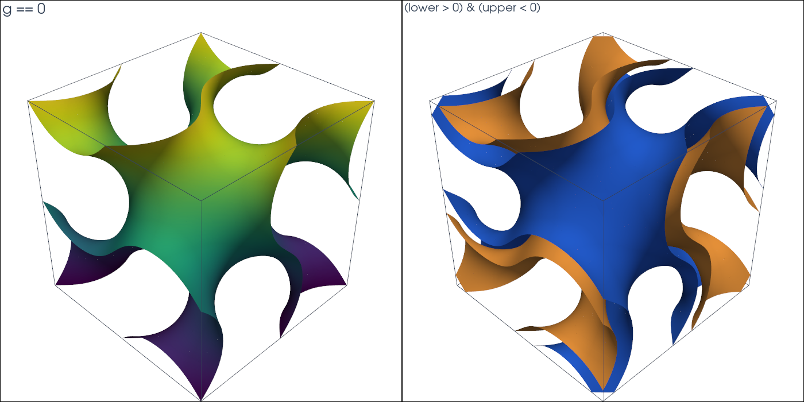

# Gyroid

This tutorial follows `python/demo/demo_gyroid.py`. A triply periodic minimal
surface, the gyroid, is cut out of a hexahedral mesh, and a sheet around it
is selected between two level sets.

```{raw} html
<figure class="tutorial-figure">
  <iframe class="tutorial-frame" src="../_static/tutorials/gyroid-view.html" title="Interactive view of the gyroid sheet" loading="lazy" allowfullscreen></iframe>
  <figcaption>The two faces of the gyroid sheet, lower == 0 (blue) and upper == 0 (orange), in one unit cell. Drag to turn, scroll to zoom.</figcaption>
</figure>
```

## Geometry

On the unit cell $[0,L]^3$ the gyroid is approximated by the zero set of

$$
g(x)=\sin kx\,\cos ky+\sin ky\,\cos kz+\sin kz\,\cos kx,\qquad k=\frac{2\pi}{L}.
$$

It splits the cell into two congruent labyrinths, so each of $\{g<0\}$ and
$\{g>0\}$ fills exactly half of the cell, and its area in one cell is about
$3.09\,L^2$. Lattices of this kind are used for lightweight structures, heat
exchangers and scaffolds.

## Hexahedral Mesh

`box_mesh(..., cell_type="hexahedron")` builds a box of hexahedra in VTK node order;
`n = 17` points per side give 4096 cells. The level set is a P3 interpolant
of $g$:

```python
mesh = cutcells.box_mesh(0.0, 0.0, 0.0, LENGTH, LENGTH, LENGTH, n, n, n, cell_type="hexahedron")
g = cutcells.create_level_set(mesh, gyroid, degree=3, name="g")
result = cutcells.cut(mesh, g)

fraction = result[g < 0].quadrature(order=4).weights.sum() / LENGTH**3
area = result[g == 0].quadrature(order=4).weights.sum() / LENGTH**2
```

Quadrilaterals and hexahedra are cut like simplices. quadrays integrates
affine cells, such as these parallelepipeds; the lookup tables
(`backend="lut"`) also take general quadrilaterals, hexahedra, prisms and
pyramids.

## A Sheet Between Two Level Sets

The sheet $\{-t<g<t\}$ is the part between the level sets $g+t$ and $g-t$,
both inside the cell:

```python
lower = cutcells.create_level_set(mesh, lambda X: gyroid(X) + SHEET, degree=3, name="lower")
upper = cutcells.create_level_set(mesh, lambda X: gyroid(X) - SHEET, degree=3, name="upper")
sheet_result = cutcells.cut(mesh, [lower, upper])

sheet = sheet_result[(lower > 0) & (upper < 0)]
faces = sheet_result[lower == 0], sheet_result[upper == 0]
```

The sheet's volume comes from its quadrature; its two faces are drawn in the
view above.

```{raw} html
<figure class="tutorial-figure">
  
  <figcaption>Left: g == 0, coloured by height. Right: the faces of the sheet (lower &gt; 0) &amp; (upper &lt; 0).</figcaption>
</figure>
```

## Results

```text
hexahedra: 4096, cut by g: 1248
volume fraction of g < 0:  0.500000000003  (exact 1/2, error 2.9e-12)
area of g = 0, quadrays:   3.09164427 L^2
area of g = 0, lut:        3.09422760 L^2
volume fraction of sheet:  0.25832662
```

The volume fraction is exact up to round-off, as the interpolant keeps the
point symmetry $g(L-x)=-g(x)$ that swaps the two labyrinths. The area has no
closed form; the straight pieces of the lookup tables differ from the curved
pieces of quadrays by $2.6\cdot10^{-3}$, almost $10^{-3}$ relative, on this
mesh.

## Run the Demo

```bash
python python/demo/demo_gyroid.py
python python/demo/demo_gyroid.py --n 33 --no-plot
```

Options: `--n` grid points per side, `--degree` of the level sets, `--order`
of the quadrature, `--output-dir` for the VTU files, `--no-plot` and
`--screenshot file.png`.
