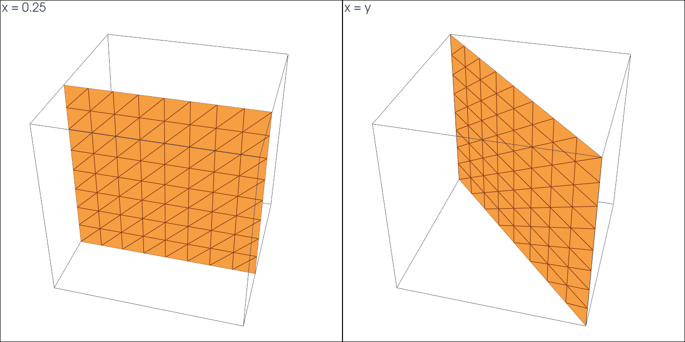

# Plane on mesh facets

This tutorial follows `python/demo/demo_mesh_aligned.py`. A level set can vanish
on whole facets of the mesh, as fitted geometry does. No cell is cut there, and
the surface belongs to both cells that share each facet. CutCells integrates
it once, on the facets, and you choose which cells take it.

```{raw} html
<figure class="tutorial-figure">
  
  <figcaption>The planes x = 0.25, on grid faces, and x = y, on the diagonal faces of the tetrahedra, drawn from their facets.</figcaption>
</figure>
```

## Geometry

The mesh covers $[-1,1]^3$ with 3072 tetrahedra, and one level set is used at a
time:

$$
\phi_1(x)=x-0.25\ \ (\text{area }4),\qquad
\phi_2(x)=x-y\ \ (\text{area }4\sqrt2).
$$

## Rules on the Facets

`entity_quadrature` returns the rules on the facets, one rule per facet with
the cells that share it:

```python
phi = cutcells.create_level_set(mesh, lambda X: X[0] - 0.25, degree=1, name="phi")
result = cutcells.cut(mesh, phi)
face = result[phi == 0]

on = face.entity_quadrature(order=2).facets
on.weights.sum()    # the area, each facet once
on.cells            # per rule, the cells sharing the facet
```

## Rules in the Cells

For assembly over cells, `quadrature(entities=...)` folds these rules into the
cell rules. Every policy integrates the same surface and sends it to different
cells:

| `entities=` | Which cells take a facet's rule |
| --- | --- |
| `"split"` (default) | both sharing cells, each with half the weight |
| `"negative"` | the cell on the side $\phi<0$ |
| `"positive"` | the cell on the side $\phi>0$ |
| `"owner"` | the sharing cell of lowest index |
| `"exclude"` | none: use `entity_quadrature` |

## Results

```text
tetrahedra: 3072
x = 0.25: cut cells 0, facets on the plane 128
  on the facets, once each: area 4.00000000000000, exact 4.00000000000000
  volume phi < 0: 5.00000000000000, exact 5.00000000000000
     entities=    area in cell rules   cells with points
         split      4.00000000000000                 256
      negative      4.00000000000000                 128
      positive      4.00000000000000                 128
         owner      4.00000000000000                 128
       exclude      0.00000000000000                   0
x = y: cut cells 0, facets on the plane 128
  on the facets, once each: area 5.65685424949238, exact 5.65685424949238
  volume phi < 0: 4.00000000000000, exact 4.00000000000000
     entities=    area in cell rules   cells with points
         split      5.65685424949238                 256
      negative      5.65685424949238                 128
      positive      5.65685424949238                 128
         owner      5.65685424949238                 128
       exclude      0.00000000000000                   0
```

See [Quadrature and output](../user-guide/quadrature-output.md) for all fields
of the rules.

## Run the Demo

```bash
python python/demo/demo_mesh_aligned.py
```

Options: `--n` grid points per side ($8k+1$, so that $x=0.25$ is on the grid),
`--order` of the quadrature, `--output-dir` for the VTU files, `--no-plot` and
`--screenshot file.png`.
