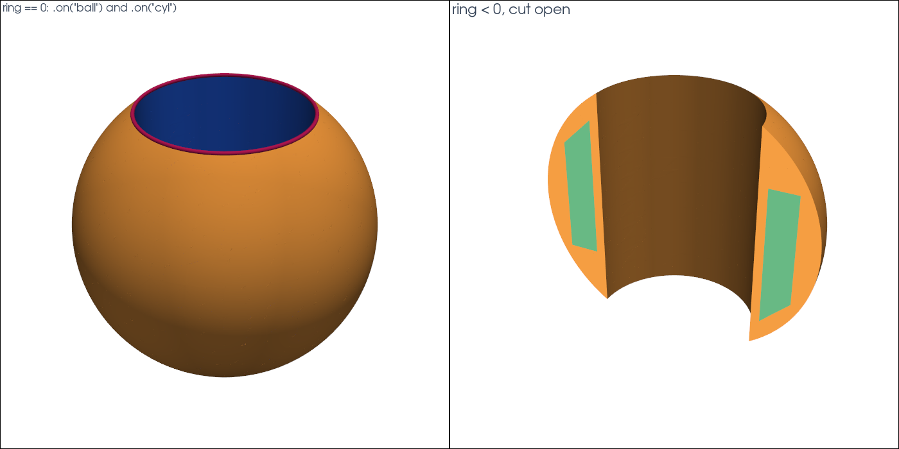

# Napkin ring

This tutorial follows `python/demo/demo_napkin_ring.py`. A shape with sharp
edges is given as a **level set made of level sets**: CutCells cuts with its
smooth level sets, so the edges are exact, and the faces of its surface can
be selected one by one.

```{raw} html
<figure class="tutorial-figure">
  <iframe class="tutorial-frame" src="../_static/tutorials/napkin-ring-view.html" title="Interactive view of the napkin ring" loading="lazy" allowfullscreen></iframe>
  <figcaption>The surface of the napkin ring: the sphere zone (orange), the wall of the hole (blue) and the two rims where they meet (magenta). Drag to turn, scroll to zoom.</figcaption>
</figure>
```

## Geometry

Drill a cylindrical hole of radius $a$ through the centre of a ball of radius
$R$. What is left is a napkin ring of height $h=2\sqrt{R^2-a^2}$, whose
volume depends on $h$ alone:

$$
|\text{ring}|=\frac{\pi h^3}{6}.
$$

Its surface has two faces, the sphere zone and the wall of the hole, of areas
$2\pi R h$ and $2\pi a h$, which meet in two circles of radius $a$. The demo
uses $R=0.8$ and $a=0.45$.

## Why a Level Set Made of Level Sets

A single level set for the ring, such as
$\max(\phi_\text{ball},-\phi_\text{cyl})$, has a kink along the rims. Its
interpolant rounds the kink off, and the error there decays slowly. The smooth
level sets themselves have no kink: given both, CutCells finds the rims as the
curves where both vanish.

A `LevelSetFunction` takes the level sets it is made of and its inside, a
condition on them:

```python
ball = cutcells.analytic_sphere([0.0, 0.0, 0.0], BALL_RADIUS, name="ball")
cyl = cutcells.create_level_set(mesh, cylinder, degree=3, name="cyl")
ring = cutcells.LevelSetFunction(level_sets=[ball, cyl], inside=(ball < 0) & (cyl > 0), name="ring")

result = cutcells.cut(mesh, ring)
result.level_set_names   # ['ring.ball', 'ring.cyl']
result.insides           # {'ring': 'ball < 0 and cyl > 0'}
```

The ball is exact and the cylinder a P3 interpolant: the parts of one level
set made of level sets may be of different kinds.

## Selecting the Ring and its Faces

The ring is selected like any level set. `ring < 0` is its inside,
`ring == 0` its surface, and `part.on(...)` keeps the faces on the level sets
named:

```python
solid = result[ring < 0]                  # ball < 0 and cyl > 0
surface = result[ring == 0]
zone = surface.on("ball")                 # the sphere zone
hole = surface.on("cyl")                  # the wall of the hole
rims = result[(ball == 0) & (cyl == 0)]   # the two circles
```

Conditions on the level sets it is made of select by their full names:
`result[cyl < 0]` is `result["ring.cyl < 0"]`.

```{raw} html
<figure class="tutorial-figure">
  
  <figcaption>Left: the faces of ring == 0 and the rims. Right: ring &lt; 0 cut open by a plane, a third level set; in the section, background cells inside the ring are green and cells cut by its surface orange.</figcaption>
</figure>
```

## Results

```text
level sets: ['ring.ball', 'ring.cyl'], insides: {'ring': 'ball < 0 and cyl > 0'}
cut cells: 2832, ring height h = 1.322876
    part  dim         measure           exact      error
    ring    3    1.2121527673    1.2121481286   4.64e-06
 surface    2   10.3898449485   10.3898411026   3.85e-06
    zone    2    6.6495067813    6.6494983057   8.48e-06
    hole    2    3.7403381672    3.7403427969   4.63e-06
    rims    1    5.6548531364    5.6548667765   1.36e-05
```

The errors are those of the P3 cylinder. Its error at the rims, where it
meets the ball, shifts area between the zone and the hole, so that their
errors partly cancel on the whole surface. With `--degree 4` the volume error
is 4.7e-7 and the rim error 1.6e-6, with `--degree 2` 9.6e-5 and 6.2e-4.

## Run the Demo

```bash
python python/demo/demo_napkin_ring.py
python python/demo/demo_napkin_ring.py --degree 4 --no-plot
```

Options: `--n` grid points per side, `--degree` of the cylinder, `--order` of
the quadrature, `--output-dir` for the VTU files, `--no-plot` and
`--screenshot file.png`.
