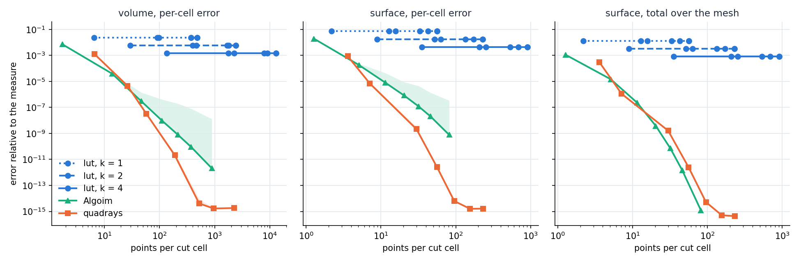

# Points and Accuracy

This tutorial follows `python/demo/demo_points_accuracy.py`. What matters in
assembly is the error a rule reaches for its number of points. The demo compares
four kinds of rule on one sphere: the lookup tables, plain quadrays points,
quadrays' defaults, and Algoim.

```{raw} html
<figure class="tutorial-figure">
  
  <figcaption>Error against points per cut cell, on hexahedra, for 16 placements of the sphere. Lines are medians, the green band reaches Algoim's worst placement (quadrays' band is about the width of its line). Left and centre: per-cell error sums. Right: the error of the total over the mesh.</figcaption>
</figure>
```

## The Rules

The level set is the quadratic $|x-c|^2-R^2$ with $R=0.7$, interpolated exactly
by P2, so only the rule's error remains. The mesh has 16 grid cells per side,
each a hexahedron or six tetrahedra. Below, $q$ is the points per segment and sets
the accuracy of quadrays' rules, as the order does.

```python
def quadrays_options(q, plain):
    options = cutcells.QuadraysOptions()
    options.points_per_segment = q
    if plain:
        options.anchor_folds = 0
        options.tolerance = -1.0
    return options

rules = result[phi == 0].quadrature(order=10, mode="cut_only", options=quadrays_options(q, False))
lut = result[phi == 0].quadrature(order=4, mode="cut_only", backend="lut",
                                  options=cutcells.LutOptions(template_order=k))
```

`quadrays`
: The defaults: points anchored at the folds of the height functions, and an
  accuracy check that bisects a box when its moments do not settle.

`plain`
: Gauss points along the height directions, with no anchoring or check. This is
  the construction of Saye (2015).

`lut, k`
: The lookup tables: the level set's cell is refined into $k$ parts per edge and
  each part is cut along straight lines.

`Algoim`
: [Algoim](https://algoim.github.io/), Saye's library, driven through the
  comparison programs in `benchmarks/quadrays`.

On hexahedra, plain quadrays and Algoim's Gauss rule are the same rule. In
`quadrays_study` they give equal point counts and errors, to all printed digits:

```text
mesh    n  q generator      part     |     cut |  pts/cut |    global        L1     worst | bisect uncert |   us/cut
hex    16  5 quadrays-f0:0.25:-1 phi < 0  |     591 |    214.5 |   5.1e-12   7.7e-11   3.0e-07 |      0      0 |     85.8
hex    16  5 algoim-gl      phi < 0  |     591 |    214.5 |   5.1e-12   7.7e-11   3.0e-07 |      0      0 |    359.9
hex    16  5 quadrays-f0:0.25:-1 phi = 0  |     591 |     31.7 |   5.9e-11   3.4e-09   8.6e-07 |      0      0 |     83.8
hex    16  5 algoim-gl      phi = 0  |     591 |     31.7 |   5.9e-11   3.4e-09   8.6e-07 |      0      0 |    271.2
```

So any difference in the figure comes from what quadrays adds, and not from
different underlying rules. (These errors are relative to the measure; the tables
below are absolute.)

## Lookup Tables Stop Early

```text
hexahedron, cut cells: 591; q is the points per segment (the order for lut)
    part       rule  q  points/cut  us/cut  per-cell err  total err
  volume lut, k = 1  1         6.5      39       3.4e-02    3.4e-02
  volume lut, k = 1  4        90.5      41       3.4e-02    3.4e-02
  volume lut, k = 2  1        29.2      92       8.6e-03    8.6e-03
  volume lut, k = 2  4       429.9     165       8.6e-03    8.6e-03
  volume lut, k = 4  1       134.7     334       2.1e-03    2.1e-03
  volume lut, k = 4  4      2153.2    1050       2.1e-03    2.1e-03
```

A higher order changes nothing: the straight pieces integrate the wrong region,
and the order only integrates it more exactly. Refining falls as $k^{-2}$, like
refining the mesh, and the points grow more than fourfold per doubling. quadrays reaches the 2.1e-3 of
`k = 4` with 6.4 points, against 134.7.

So keep the lookup tables for what they do well: flat zero sets (see
[Cell shapes](cell-shapes.md)) and low accuracy at small cost per cell.

## What Anchoring and the Check Buy

```text
hexahedron
    part       rule  q  points/cut  us/cut  per-cell err  total err
  volume   quadrays  3        58.9     118       4.6e-08    2.5e-09
  volume   quadrays  4       192.7     199       3.8e-11    2.1e-11
  volume   quadrays  5       505.2     382       5.2e-15    2.1e-15
  volume      plain  3        46.3      22       3.2e-07    4.6e-08
  volume      plain  5       214.5      41       1.1e-10    7.3e-12
  volume      plain  6       370.6      60       4.4e-12    1.1e-13
  volume      plain  8       878.5     109       1.7e-14    0.0e+00
 surface   quadrays  3        29.0     178       1.1e-08    8.8e-09
 surface   quadrays  4        54.1     252       1.6e-11    1.4e-11
 surface   quadrays  5        94.4     431       3.6e-14    3.0e-14
 surface      plain  5        31.7      29       2.1e-08    3.6e-10
 surface      plain  6        45.7      36       1.4e-09    7.2e-12
 surface      plain  8        81.2      54       8.7e-12    3.6e-15
```

Compare rows of about equal points. At about 30 surface points the two are even
per cell. By 50 quadrays is about 100 times better, and by 80 to 90 about 200
times better, and it continues to round-off. On the volume, the gain at 200
points is about three times.

The rest of the comparison is less flattering, so here it is plainly:

- **Plain points are better at the totals on hexahedra.** At about 30 surface
  points plain has a total error of 3.6e-10 against 8.8e-9, and the figure's right
  panel shows the same for Algoim. Errors of neighbouring cells cancel, and more
  so for plain points. If you only need an integral over the whole surface of a
  smooth function, plain points do well.
- **The defaults take more time.** quadrays spends about 5 to 15 times as long as
  plain points at the same $q$, in the check and on the extra factors. Timings are
  from a busy machine, so read them for their size only.
- **The worst placement matters.** The green band in the figure is what per-cell
  numbers show and medians hide: at $q = 8$ Algoim's volume error is 2.1e-12 for
  the median placement and 1.3e-8 for the worst, and its surface error 7.8e-10
  and 3.4e-7. quadrays stays within a factor of about two over the 16 placements.

## Tetrahedra Gain the Most

On tetrahedra, plain points stall, and the totals do not rescue them:

```text
tetrahedron, cut cells: 2698
    part       rule  q  points/cut  us/cut  per-cell err  total err
  volume   quadrays  4       228.7     391       5.4e-11    2.4e-11
  volume   quadrays  5       511.1     683       7.7e-14    3.2e-14
  volume      plain  4       196.6     101       1.6e-08    4.0e-09
  volume      plain  6       663.7     179       1.3e-10    8.1e-11
  volume      plain  8      1573.2     339       2.6e-12    2.1e-12
 surface   quadrays  4        34.4     304       7.5e-11    2.2e-11
 surface   quadrays  5        61.7     449       9.8e-14    5.1e-14
 surface      plain  5        41.7     114       4.3e-07    2.5e-07
 surface      plain  6        60.1      93       6.4e-08    4.7e-08
 surface      plain  8       106.8     134       2.0e-09    1.8e-09
```

At about 60 surface points, quadrays is six orders of magnitude better than plain
points, per cell and in total.

:::{admonition} Which rule to use
:class: practice

- A P1 level set on simplices, or low accuracy cheaply: `backend="lut"`.
- Curved geometry, assembled cell by cell: quadrays' defaults, the order you need
  from [Degree and order](degree-order.md).
- Whole-surface integrals on hexahedra, at many evaluations:
  `anchor_folds = 0` and `tolerance = -1` are worth trying; check the accuracy on
  your geometry.
- Fewer points whatever the generator: [Compression](compression.md).
:::

## Run the Demo

```bash
python python/demo/demo_points_accuracy.py
python python/demo/demo_points_accuracy.py --cell-type tetrahedron --no-plot
```

Options: `--cell-type` of the mesh, `--n` grid points per side, `--sweep file.csv`
to add the Algoim curves to the plot, `--no-plot` to skip the matplotlib window
and `--screenshot file.png` to save the plot.

The Algoim data of the figure come from the benchmarks, which need the
`-DCUTCELLS_WITH_ALGOIM=ON` build of `benchmarks/`:

```bash
quadrays_sweep --mesh hex --n 16 --steps 16 --q 1,2,3,4,5,6,8 --gen quadrays,lut:1,lut:2,lut:4,algoim --csv sweep.csv
quadrays_study --mesh hex --n 16 --q 3,5,8 --radius 0.7 --centre 0.0123,-0.0371,0.0217 --gen quadrays-f0:0.25:-1,algoim-gl --part 'phi < 0' --part 'phi = 0'
```
