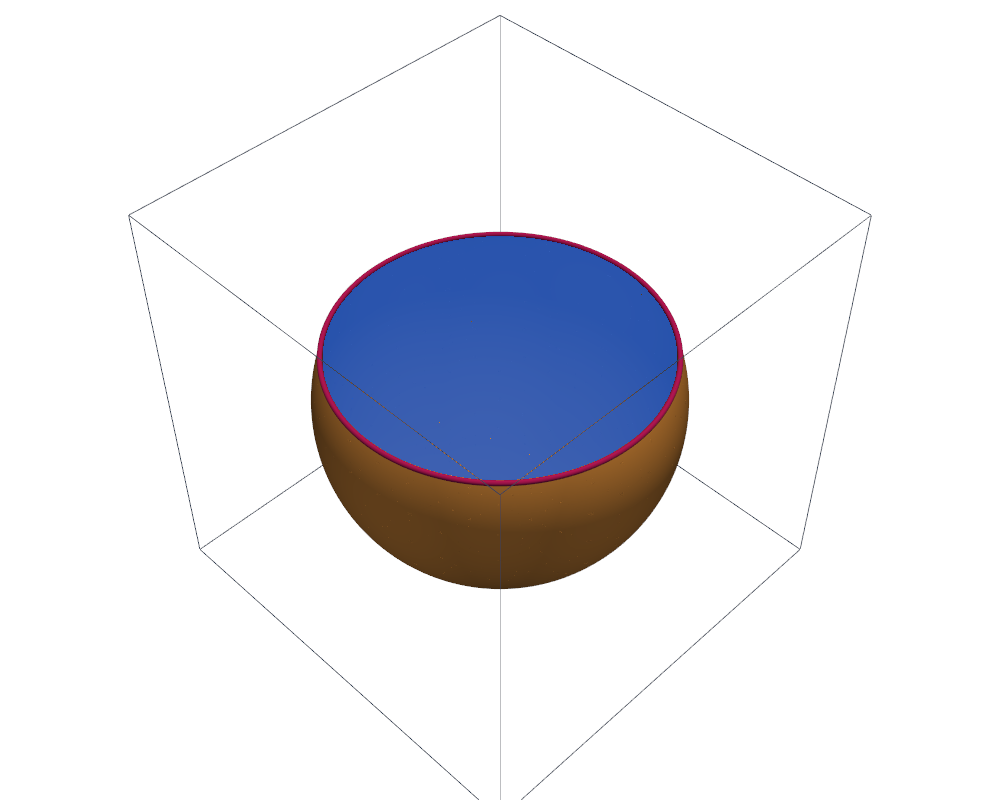

# Ball and plane

This tutorial follows `python/demo/demo_sphere_plane.py`. Two level sets cut
the mesh at once, and conditions on both select parts of every dimension: a
volume, two surfaces and a curve.

```{raw} html
<figure class="tutorial-figure">
  <iframe class="tutorial-frame" src="../_static/tutorials/sphere-plane-view.html" title="Interactive view of the ball and the plane" loading="lazy" allowfullscreen></iframe>
  <figcaption>The sphere below the plane (orange), the disk where the plane crosses the ball (blue) and the circle where they meet (magenta). Drag to turn, scroll to zoom.</figcaption>
</figure>
```

## Geometry

A ball of radius $R=0.8$ about the origin and the plane $z=z_0$, $z_0=0.3$,
give the level sets

$$
\phi_\text{ball}(x)=|x|-R,\qquad \phi_\text{plane}(x)=z-z_0 .
$$

The plane crosses the ball in a disk of radius $a=\sqrt{R^2-z_0^2}$. The
exact measures of the parts are

$$
\begin{aligned}
|\{\phi_\text{ball}<0,\ \phi_\text{plane}<0\}| &= \tfrac43\pi R^3-\tfrac13\pi(R-z_0)^2(2R+z_0),\\
|\{\phi_\text{ball}=0,\ \phi_\text{plane}<0\}| &= 2\pi R\,(R+z_0),\\
|\{\phi_\text{plane}=0,\ \phi_\text{ball}<0\}| &= \pi a^2,\\
|\{\phi_\text{ball}=0,\ \phi_\text{plane}=0\}| &= 2\pi a .
\end{aligned}
$$

## Two Level Sets

The ball is analytic and the plane a P1 level set; `cut` takes them as a
list:

```python
mesh = cutcells.structured_tetrahedron_mesh_view(-1.0, -1.0, -1.0, 1.0, 1.0, 1.0, n, n, n)
ball = cutcells.analytic_sphere([0.0, 0.0, 0.0], RADIUS, name="ball")
plane = cutcells.create_level_set(mesh, lambda X: X[2] - HEIGHT, degree=1, name="plane")
result = cutcells.cut(mesh, [ball, plane])
```

`result.level_set_names` is `['ball', 'plane']`, and `result.domains` holds,
per level set and cell, whether the cell is inside, cut or outside.

## Selections of Every Dimension

`&` combines conditions; each comparison needs its parentheses. The dimension
of a part follows from its equality clauses: none gives a volume, one a
surface, two a curve.

```python
below = result[(ball < 0) & (plane < 0)]      # dim 3
cap = result[(ball == 0) & (plane < 0)]       # dim 2
disk = result[(plane == 0) & (ball < 0)]      # dim 2
circle = result[(ball == 0) & (plane == 0)]   # dim 1

length = circle.quadrature(order=4).weights.sum()
```

The same selections as strings read `"ball < 0 and plane < 0"`,
`"ball = 0 and plane = 0"`; `str(condition)` writes a condition as its
string. `|` gives unions, such as `(ball < 0) | (plane < 0)`. See
[Cut results and selections](../user-guide/selections.md).

## Views

Every part has a visualisation mesh; the curve is drawn as a tube:

```python
def surface(part, subdivision=3):
    mode = "full" if part.dim == 3 else "cut_only"
    grid = cutcells.to_pyvista(part.visualization_mesh(mode=mode, degree=3))
    return grid.extract_surface(nonlinear_subdivision=subdivision, algorithm="dataset_surface")

plotter.add_mesh(surface(cap), color="#f59e42", smooth_shading=True)
plotter.add_mesh(surface(disk), color="#2563eb", opacity=0.85)
plotter.add_mesh(surface(circle, 4).tube(radius=0.012), color="#be185d")
```

```{raw} html
<figure class="tutorial-figure">
  
  <figcaption>The PyVista view of the demo.</figcaption>
</figure>
```

## Results

```text
level sets: ['ball', 'plane'], cut cells: 2582
                    part                     selection  dim           measure      error
    ball below the plane        ball < 0 and plane < 0    3    1.647241746757   1.28e-09
  sphere below the plane        ball = 0 and plane < 0    2    5.529205657544   2.59e-06
                    disk        plane = 0 and ball < 0    2    1.727875963530   4.06e-09
                  circle        ball = 0 and plane = 0    1    4.659734934969   1.96e-09
```

## Run the Demo

```bash
python python/demo/demo_sphere_plane.py
```

Options: `--n` grid points per side, `--order` of the quadrature,
`--output-dir` for the VTU files of the four parts, `--no-plot` and
`--screenshot file.png`.
