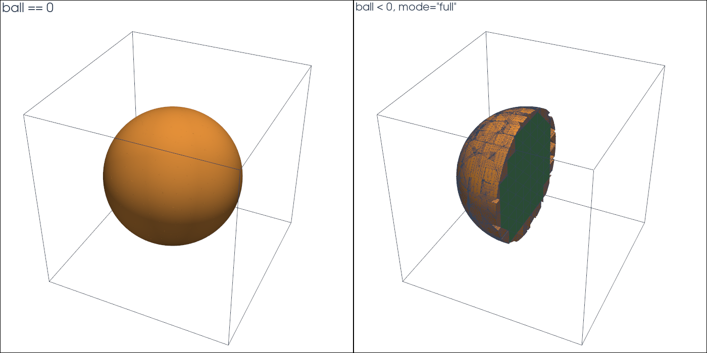

# Ball in a tetrahedral mesh

This tutorial follows `python/demo/demo_sphere.py`. It moves the workflow to
3D: a ball cut out of a tetrahedral mesh, given once as exact geometry and
once as an interpolated level set, with curved Lagrange cells as output.

```{raw} html
<figure class="tutorial-figure">
  
  <figcaption>Left: the sphere ball == 0, drawn from the curved pieces of the cut cells. Right: the ball ball &lt; 0 in mode="full" behind a plane, whole cells in green and the curved pieces of the cut cells in orange.</figcaption>
</figure>
```

## Geometry

The background mesh covers the cube $[-1,1]^3$. The ball of radius $R=0.7$
about $c$ is $B=\{x : |x-c|<R\}$, with

$$
|B|=\tfrac43\pi R^3,\qquad |\partial B|=4\pi R^2 .
$$

## Implementation Order

1. Build a structured tetrahedral `MeshView`.
2. Make the ball twice: `analytic_sphere`, and a P2 interpolant of the same
   function.
3. Cut by each and select `ball < 0` and `ball == 0`.
4. Compare volumes and areas with the exact values.
5. Write curved VTU files and show the parts with PyVista.

## Background Mesh

`box_mesh(..., cell_type="tetrahedron")` splits every grid cube into six
tetrahedra around its diagonal. The mesh is conforming and needs only NumPy;
`n = 13` points per side give 10368 tetrahedra.

```python
mesh = cutcells.box_mesh(-1.0, -1.0, -1.0, 1.0, 1.0, 1.0, n, n, n, cell_type="tetrahedron")
```

For meshes from elsewhere, `MeshView(coordinates, connectivity, offsets,
cell_types, tdim)` takes the flat arrays of any mesh of the supported cell
types, and `mesh_from_pyvista` converts a PyVista grid.

## Exact and Interpolated Level Sets

An analytic level set gives values, gradients and bounds of both over boxes.
`cut` classifies cells by the bounds, and quadrays integrates the level set
itself, with no interpolant. The interpolated ball is the P2 interpolant of
the signed distance:

```python
exact = cutcells.analytic_sphere(CENTER, RADIUS, name="ball")
interpolated = cutcells.create_level_set(mesh, sphere, degree=2, name="ball")

for ball in (exact, interpolated):
    result = cutcells.cut(mesh, ball)
    inside = result[ball < 0]
    surface = result[ball == 0]
    volume = inside.quadrature(order=4).weights.sum()
    area = surface.quadrature(order=4).weights.sum()
```

Other analytic level sets come from Python callables
(`cutcells.AnalyticLevelSet`), from compiled geometry libraries through a
capsule, or from ShapeForest shapes; see [Level sets](../user-guide/level-sets.md).

## Curved Output

A part's visualisation mesh holds Lagrange cells of the given degree: for the
sphere, curved triangles and quadrilaterals; for the ball in `mode="full"`,
the whole tetrahedra and the curved pieces of the cut cells. Each piece knows
its background cell (`parent`):

```python
inside.write_vtu("ball.vtu", mode="full", degree=3)
surface.write_vtu("sphere.vtu", mode="cut_only", degree=3)
```

In PyVista, `extract_surface(nonlinear_subdivision=...)` draws the Lagrange
cells curved:

```python
sphere_surface = cutcells.to_pyvista(surface.visualization_mesh(mode="cut_only", degree=3))
plotter.add_mesh(sphere_surface.extract_surface(nonlinear_subdivision=3, algorithm="dataset_surface"),
                 color="#f59e42", smooth_shading=True)

ball = cutcells.to_pyvista(inside.visualization_mesh(mode="full", degree=3))
ball.cell_data["cut"] = np.isin(ball.cell_data["parent"], result.cut_cells).astype(int)
```

## Results

```text
background cells: 10368, cut cells: 1524
 level set   volume error   area error
     exact       5.55e-09     6.22e-06
        P2       1.38e-05     1.32e-04
```

With the P2 level set both errors are the interpolation error. With exact
geometry the area error at `order=4` is set by the Gauss points per segment
on the curved pieces (see [Convergence](convergence.md)); with
`QuadraysOptions.points_per_segment = 12` it drops to 2e-12.

## Run the Demo

```bash
python python/demo/demo_sphere.py
python python/demo/demo_sphere.py --n 17 --no-plot
```

Options: `--n` grid points per side, `--order` of the quadrature,
`--output-dir` for the VTU files, `--no-plot` and `--screenshot file.png`.
