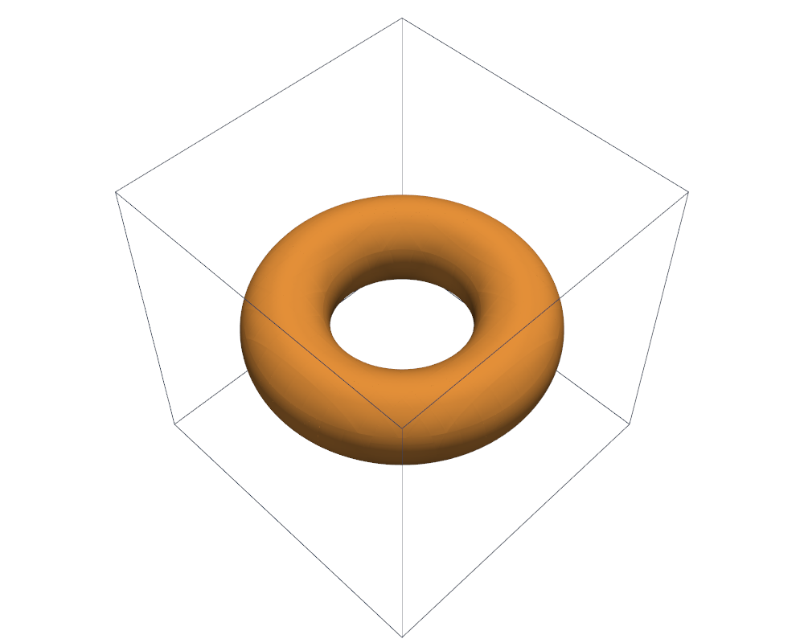

# Torus

This tutorial follows `python/demo/demo_torus.py`. A torus, a surface with a
hole, is cut out of a hexahedral mesh, first as an interpolated level set, then
as an analytic level set written in Python.

```{raw} html
<figure class="tutorial-figure">
  <iframe class="tutorial-frame" src="../_static/tutorials/torus-view.html" title="Interactive view of the torus" loading="lazy" allowfullscreen></iframe>
  <figcaption>The surface of the torus from the curved pieces of the cut hexahedra. Drag to turn, scroll to zoom.</figcaption>
</figure>
```

## Geometry

With radii $R=0.65$ and $r=0.25$ about the $z$ axis,

$$
\phi(x)=\sqrt{(\rho-R)^2+z^2}-r,\quad \rho=\sqrt{x^2+y^2},\qquad
|T|=2\pi^2Rr^2,\quad |\partial T|=4\pi^2Rr .
$$

## Interpolated Level Sets

```python
mesh = cutcells.box_mesh(-1.0, -1.0, -1.0, 1.0, 1.0, 1.0, n, n, n, cell_type="hexahedron")
phi = cutcells.create_level_set(mesh, torus, degree=3, name="phi")
result = cutcells.cut(mesh, phi)

volume = result[phi < 0].quadrature(order=4, mode="full").weights.sum()
area = result[phi == 0].quadrature(order=4).weights.sum()
```

```{raw} html
<figure class="tutorial-figure">
  
  <figcaption>The PyVista view of the demo.</figcaption>
</figure>
```

## A Level Set of Your Own

An analytic level set is three functions of points in physical space: its
value, its gradient, and bounds of both over a box. The bounds let quadrays
decide for a whole box that a cell is not cut, and along which direction the
surface is a height function:

```python
def box_bounds(lo, hi):
    ...                                     # interval arithmetic, see the demo
    bounds = [d[0] - MINOR, d[1] - MINOR]   # phi over the box
    if d[0] <= 0.0 or rho[0] <= 0.0:
        return bounds                       # the gradient has no bound here
    ...
    return bounds                           # then lower and upper per gradient component

phi = cutcells.AnalyticLevelSet(value, gradient, box_bounds, name="phi")
```

Each call crosses into Python, so this is for experiments and small meshes. For
production use, compile the functions and pass them as a capsule
(`cutcells.AnalyticLevelSet.from_capsule`); see
[Level sets](../user-guide/level-sets.md).

## Results

```text
hexahedra: 4096, cut cells: 568
 level set   volume error   area error
        P2       1.69e-04     8.34e-04
        P3       1.75e-05     5.15e-05
        P4       2.34e-06     6.07e-06
```

With `--analytic` the same mesh gives a volume error of 1.0e-12 and an area
error of 9.0e-11. That run took about 100 seconds, against about 3 seconds for
each interpolated level set.

## Run the Demo

```bash
python python/demo/demo_torus.py
python python/demo/demo_torus.py --analytic --no-plot
```

Options: `--n` grid points per side, `--order` of the quadrature, `--analytic`,
`--output-dir` for the VTU files, `--no-plot` and `--screenshot file.png`.
